# Auditoría de la base de datos — SGCPC v1.0

Auditoría SOLO LECTURA de `sgcpc_db_pruebas` (nunca `sgcpc_db`), conectado como `sgcpc_user`,
realizada el 15/10/2026 sobre el commit `3a248af` (tags `v1.0-estable`/`lote2-D1-probado`).
Herramientas usadas: `SELECT` sobre `information_schema`/`pg_catalog`, `\d`, `pg_dump --schema-only`.
Ningún dato ni código fue modificado para esta auditoría. Es un diagnóstico — no incluye
recomendaciones de cambio (eso queda para una etapa posterior, a pedido explícito de Joel).

**Nota (Commit 3, 18/10/2026)**: las columnas `id_codeudor`/`ingreso_codeudor_evaluado`
(`solicitudes_credito`), `aplica_codeudor` (`tipos_documento`) y el parámetro
`credito.exigir_garante`, descriptas más abajo tal como existían en la fecha de esta auditoría,
se eliminaron del esquema con el retiro de codeudor/garante — ver
`docs/base_de_datos/02_analisis_y_problemas.md` §9 y `04_esquema_actual.md`.

**Nota (18/10/2026, ronda de columnas sin uso)**: `tipos_documento.aplica_cliente`/
`requiere_firma`/`origen_esperado` y `desembolsos.monto_deducciones`, descriptas más abajo tal
como existían en la fecha de esta auditoría, se eliminaron por no tener ningún efecto en el
código; `prestamos.limite_tasa_id` y `sesiones_caja.gerente_revisa_id` (las 2 FK señaladas más
abajo con el sufijo `_id` fuera de patrón) se renombraron a `id_limite_tasa`/
`id_gerente_revisor` — ver `docs/base_de_datos/02_analisis_y_problemas.md` §7 y
`04_esquema_actual.md`.

---

## 1. Resumen

| Objeto | Cantidad |
|---|---|
| Tablas | 30 |
| Vistas | 0 |
| Secuencias (`pg_sequences`; una por cada PK `GENERATED ALWAYS AS IDENTITY`, salvo `numeradores` que tiene clave compuesta) | 29 |
| Funciones propias (`plpgsql`) | 2 |
| Triggers | 14 (12 vía un mismo patrón `BEFORE DELETE` + 2 sobre `auditoria_operaciones`) |
| Índices | 85 (30 `_pkey` + 25 `UNIQUE` con nombre propio + 25 `ix_*`/`ux_*` no únicos o parciales + 5 `_key` adicionales) |
| Dominios / tipos ENUM propios | 0 (el proyecto usa `VARCHAR` + `CHECK` en vez de `ENUM`/dominios nativos) |
| **Tamaño total de la base** | **48 MB** (`pg_database_size`) |

Fila/tamaño por tabla (filas = `COUNT(*)` real, no el estimado de `pg_class.reltuples`, que está
desactualizado porque no se corrió `ANALYZE` — correr `ANALYZE` hubiera escrito en el catálogo,
fuera del alcance de "solo lectura"):

| Tabla | Filas | Tamaño total (datos+índices) |
|---|--:|--:|
| archivos_binarios | 479 | 35 MB |
| auditoria_operaciones | 1993 | 752 kB |
| documentos_expediente | 454 | 152 kB |
| cuotas | 244 | 136 kB |
| solicitudes_credito | 57 | 136 kB |
| personas | 75 | 104 kB |
| movimientos_caja | 82 | 88 kB |
| desembolsos | 11 | 88 kB |
| facturas | 15 | 88 kB |
| consultas_crediticias | 62 | 64 kB |
| gestiones_cobranza | 9 | 64 kB |
| parametros_sistema | 85 | 64 kB |
| consentimientos_crediticios | 70 | 56 kB |
| numeradores | 9 | 56 kB |
| reversiones_pago | 6 | 80 kB |
| usuarios | 16 | 80 kB |
| prestamos | 30 | 192 kB |
| aplicaciones_pago | 32 | 24 kB |
| limites_tasa_usura | 1 | 24 kB |
| planes_pago | 36 | 40 kB |
| liquidaciones_anticipadas | 10 | 40 kB |
| feriados | 27 | 40 kB |
| ciudades | 36 | 40 kB |
| departamentos | 18 | 40 kB |
| motivos_rechazo_solicitud | 7 | 40 kB |
| sesiones_caja | 18 | 40 kB |
| tipos_documento | 14 | 40 kB |
| pagos | 22 | 104 kB |
| reversiones_desembolso | 0 | 32 kB |
| cargos_operacion | 0 | 8192 bytes |

`archivos_binarios` concentra el 73 % del tamaño total de la base (35 de 48 MB) — es la única
tabla con una columna `bytea` (los PDF/escaneos cargados), esperable.

---

## 2. Detalle por tabla

Para cada tabla: columnas (nombre, tipo, nulabilidad, default), PK, FK (con sus reglas
`ON UPDATE`/`ON DELETE`, todas `NO ACTION` en las 82 FK de la base — ver nota en §7), UNIQUE,
CHECK propios (se omiten los `NOT NULL`, ya están en la columna "Nula"), índices y triggers.

### aplicaciones_pago

| Columna | Tipo | Nula | Default |
|---|---|---|---|
| id_aplicacion_pago | bigint | NO | — |
| id_pago | bigint | NO | — |
| tipo_aplicacion | varchar(25) | NO | — |
| id_cuota | bigint | SÍ | — |
| monto_moratorio | numeric(18,0) | NO | 0 |
| monto_punitorio | numeric(18,0) | NO | 0 |
| monto_interes | numeric(18,0) | NO | 0 |
| monto_tributos | numeric(18,0) | NO | 0 |
| monto_capital | numeric(18,0) | NO | 0 |
| subtotal_aplicado | numeric(18,0) | NO | — |

- PK: `id_aplicacion_pago`.
- FK: `id_cuota → cuotas.id_cuota` (NO ACTION/NO ACTION); `id_pago → pagos.id_pago` (NO ACTION/NO ACTION).
- CHECK: `tipo_aplicacion IN ('CUOTA','ANTICIPO_CAPITAL')`; si `tipo_aplicacion='CUOTA'` entonces
  `id_cuota` no es nulo, si es `'ANTICIPO_CAPITAL'` entonces `id_cuota` es nulo; `subtotal_aplicado
  = monto_moratorio+monto_punitorio+monto_interes+monto_tributos+monto_capital`.
- Índices: solo el de la PK.
- Triggers: `trg_bloquear_eliminacion` (BEFORE DELETE → rechaza siempre).
- 32 filas, 24 kB.

### archivos_binarios

| Columna | Tipo | Nula | Default |
|---|---|---|---|
| id_archivo | bigint | NO | — |
| nombre_archivo | varchar(255) | NO | — |
| mime_type | varchar(100) | NO | — |
| extension | varchar(10) | NO | — |
| tamano_bytes | bigint | NO | — |
| contenido | bytea | NO | — |
| hash_sha256 | char(64) | NO | — |
| origen_archivo | varchar(20) | NO | — |
| fecha_carga | timestamp | NO | — |
| cargado_por | bigint | NO | — |

- PK: `id_archivo`.
- FK: `cargado_por → usuarios.id_usuario`.
- CHECK: `origen_archivo IN ('CARGADO','JASPER')`.
- Índices: solo el de la PK (sin índice en `cargado_por`, ver §7).
- Sin triggers propios (no está en la lista de `trg_bloquear_eliminacion` — es la única tabla de
  "contenido" que SÍ se puede borrar a nivel esquema; en la práctica nunca se borra porque las 9
  columnas que la referencian como caché de PDF nunca se limpian por código, ver §5).
- 479 filas, 35 MB (la tabla más grande con margen).

### auditoria_operaciones

| Columna | Tipo | Nula | Default |
|---|---|---|---|
| id_auditoria | bigint | NO | — |
| id_usuario | bigint | SÍ | — |
| fecha_hora | timestamp | NO | — |
| operacion | varchar(80) | NO | — |
| tipo_entidad | varchar(60) | NO | — |
| id_entidad | bigint | NO | — |
| valor_anterior | jsonb | SÍ | — |
| valor_nuevo | jsonb | SÍ | — |
| direccion_ip | varchar(64) | SÍ | — |
| detalle | text | SÍ | — |
| navegador | varchar(255) | SÍ | — |
| usuario_escrito | varchar(60) | SÍ | — |

- PK: `id_auditoria`.
- FK: `id_usuario → usuarios.id_usuario` (nulable: acceso con un usuario que no existe se audita
  igual, sin `id_usuario`, ver `usuario_escrito` abajo).
- Sin UNIQUE ni CHECK propios.
- Índices: `ix_auditoria_entidad (tipo_entidad, id_entidad)`, `ix_auditoria_fecha (fecha_hora)`,
  `ix_auditoria_usuario_fecha (id_usuario, fecha_hora)`, además de la PK.
- Triggers: `trg_bloquear_actualizacion` (BEFORE UPDATE) y `trg_bloquear_eliminacion` (BEFORE
  DELETE) — ambos vía `fn_bloquear_modificacion_auditoria`, "de solo inserción".
- 1993 filas, 752 kB. **Uso real de las 4 columnas de seguridad** (ver §5/§7): `direccion_ip`
  791/1993 (40 %), `navegador` 588/1993 (29 %), `usuario_escrito` 4/1993 (0,2 % — por diseño, solo
  se llena en `registrarIntentoUsuarioInexistente`, no es un hallazgo de código muerto).

### cargos_operacion

| Columna | Tipo | Nula | Default |
|---|---|---|---|
| id_cargo_operacion | bigint | NO | — |
| id_prestamo | bigint | NO | — |
| codigo_concepto | varchar(50) | NO | — |
| descripcion_concepto | varchar(180) | NO | — |
| tipo_concepto | varchar(20) | NO | — |
| monto | numeric(18,0) | NO | — |
| descuenta_desembolso | boolean | NO | — |
| incluye_en_cft | boolean | NO | — |
| orden_presentacion | smallint | NO | — |

- PK: `id_cargo_operacion`.
- FK: `id_prestamo → prestamos.id_prestamo`.
- CHECK: `tipo_concepto IN ('COMISION','GASTO','TRIBUTO','OTRO')`.
- Índices: solo el de la PK.
- Sin triggers.
- **0 filas, sin DAO, sin ningún `INSERT`/`SELECT` en el código** — ver §5 (código muerto, por
  diseño documentado: RN-17/decisión 7 del plan de E6, "cargos_operacion no se usa en V1").

### ciudades

| Columna | Tipo | Nula | Default |
|---|---|---|---|
| id_ciudad | bigint | NO | — |
| id_departamento | bigint | NO | — |
| nombre | varchar(80) | NO | — |
| activo | boolean | NO | true |

- PK: `id_ciudad`.
- FK: `id_departamento → departamentos.id_departamento`.
- UNIQUE: `(id_departamento, nombre)`.
- Índices: PK + el UNIQUE.
- Sin triggers.
- 36 filas, 40 kB.

### consentimientos_crediticios

| Columna | Tipo | Nula | Default |
|---|---|---|---|
| id_consentimiento | bigint | NO | — |
| id_persona | bigint | NO | — |
| id_solicitud | bigint | SÍ | — |
| id_documento_evidencia | bigint | NO | — |
| finalidad | varchar(250) | NO | — |
| fecha_consentimiento | timestamp | NO | — |
| registrado_por | bigint | NO | — |
| fecha_registro | timestamp | NO | — |

- PK: `id_consentimiento`.
- FK: `id_documento_evidencia → documentos_expediente.id_documento`; `id_persona →
  personas.id_persona`; `id_solicitud → solicitudes_credito.id_solicitud`; `registrado_por →
  usuarios.id_usuario`.
- Sin UNIQUE ni CHECK propios.
- Índices: solo el de la PK (sin índice en `id_persona` ni `id_solicitud`, ver §7).
- Sin triggers.
- 70 filas, 56 kB.

### consultas_crediticias

| Columna | Tipo | Nula | Default |
|---|---|---|---|
| id_consulta_crediticia | bigint | NO | — |
| id_persona | bigint | NO | — |
| id_solicitud | bigint | SÍ | — |
| id_consentimiento | bigint | NO | — |
| proveedor_buro | varchar(80) | NO | — |
| fecha_hora_consulta | timestamp | NO | — |
| consultado_por | bigint | NO | — |
| puntaje_obtenido | numeric(10,2) | SÍ | — |
| clasificacion_obtenida | varchar(100) | SÍ | — |
| indicador_mora | boolean | SÍ | — |
| resumen_resultado | text | SÍ | — |
| id_documento_resultado | bigint | SÍ | — |

- PK: `id_consulta_crediticia`.
- FK: `consultado_por → usuarios.id_usuario`; `id_consentimiento →
  consentimientos_crediticios.id_consentimiento`; `id_documento_resultado →
  documentos_expediente.id_documento`; `id_persona → personas.id_persona`; `id_solicitud →
  solicitudes_credito.id_solicitud`.
- Sin UNIQUE ni CHECK propios.
- Índices: solo el de la PK.
- Sin triggers (permite borrar una consulta al buró a nivel esquema; en la práctica nunca se usa).
- 62 filas, 64 kB.

### cuotas

| Columna | Tipo | Nula | Default |
|---|---|---|---|
| id_cuota | bigint | NO | — |
| id_plan_pago | bigint | NO | — |
| numero_cuota | smallint | NO | — |
| fecha_vencimiento | date | NO | — |
| fecha_vencimiento_teorica | date | NO | — |
| capital_programado | numeric(18,0) | NO | — |
| interes_programado | numeric(18,0) | NO | — |
| tributos_programados | numeric(18,0) | NO | — |
| total_programado | numeric(18,0) | NO | — |
| saldo_capital_posterior | numeric(18,0) | NO | — |
| estado_pago | varchar(20) | NO | — |
| iva_interes | numeric(18,0) | NO | 0 |
| moratorio_pendiente | numeric(18,0) | NO | 0 |
| punitorio_pendiente | numeric(18,0) | NO | 0 |
| iva_moratorio_pendiente | numeric(18,0) | NO | 0 |
| iva_punitorio_pendiente | numeric(18,0) | NO | 0 |
| fecha_corte_mora | date | SÍ | — |
| capital_pagado | numeric(18,0) | NO | 0 |
| interes_pagado | numeric(18,0) | NO | 0 |

- PK: `id_cuota`.
- FK: `id_plan_pago → planes_pago.id_plan_pago`.
- CHECK: `estado_pago IN ('PENDIENTE','PARCIAL','PAGADA')`. **Sin ningún CHECK que obligue
  `total_programado = capital_programado + interes_programado + tributos_programados`** (ver §7 —
  a diferencia de `pagos`/`aplicaciones_pago`, que sí tienen ese CHECK para su propia suma).
- Índices: `ix_cuotas_estado_pago`, `ix_cuotas_fecha_vencimiento`, `ix_cuotas_plan`, + PK.
- Triggers: `trg_bloquear_eliminacion`.
- 244 filas, 136 kB.

### departamentos

| Columna | Tipo | Nula | Default |
|---|---|---|---|
| id_departamento | bigint | NO | — |
| nombre | varchar(60) | NO | — |
| activo | boolean | NO | true |

- PK: `id_departamento`. UNIQUE: `nombre`. Sin FK ni CHECK propios.
- Índices: PK + UNIQUE. Sin triggers.
- 18 filas, 40 kB.

### desembolsos

| Columna | Tipo | Nula | Default |
|---|---|---|---|
| id_desembolso | bigint | NO | — |
| identificador_confirmacion | varchar(60) | NO | — |
| id_prestamo | bigint | NO | — |
| id_sesion_caja | bigint | NO | — |
| monto_aprobado_snapshot | numeric(18,0) | NO | — |
| monto_deducciones | numeric(18,0) | NO | — |
| monto_neto_entregado | numeric(18,0) | NO | — |
| fecha_hora_desembolso | timestamp | NO | — |
| desembolsado_por | bigint | NO | — |
| estado_desembolso | varchar(20) | NO | — |
| id_archivo_comprobante | bigint | SÍ | — |
| numero_comprobante | varchar(30) | SÍ | — |

- PK: `id_desembolso`.
- FK: `desembolsado_por → usuarios.id_usuario`; `id_archivo_comprobante →
  archivos_binarios.id_archivo`; `id_prestamo → prestamos.id_prestamo`; `id_sesion_caja →
  sesiones_caja.id_sesion_caja`.
- UNIQUE: `identificador_confirmacion` (idempotencia de doble clic); `numero_comprobante`.
- CHECK: `estado_desembolso IN ('CONFIRMADO','REVERTIDO')`. **Sin CHECK que obligue
  `monto_neto_entregado = monto_aprobado_snapshot - monto_deducciones`** (ver §7).
- Índices: `ix_desembolsos_prestamo` + `ux_desembolsos_un_confirmado_por_prestamo` (único PARCIAL:
  como mucho un desembolso `CONFIRMADO` por préstamo) + PK + los 2 UNIQUE de arriba.
- Triggers: `trg_bloquear_eliminacion`.
- 11 filas, 88 kB. `monto_deducciones` es 0 en las 11 filas (RN-17: "sin descuentos" en V1 — la
  columna existe para una política de cargos que todavía no se usa, ver `cargos_operacion`).

### documentos_expediente

| Columna | Tipo | Nula | Default |
|---|---|---|---|
| id_documento | bigint | NO | — |
| id_archivo | bigint | NO | — |
| id_tipo_documento | bigint | NO | — |
| id_persona | bigint | SÍ | — |
| id_solicitud | bigint | SÍ | — |
| id_prestamo | bigint | SÍ | — |
| version_documento | smallint | NO | 1 |
| estado_documento | varchar(20) | NO | — |
| id_documento_reemplazado | bigint | SÍ | — |
| fecha_documento | date | SÍ | — |
| fecha_cierre | timestamp | SÍ | — |
| cerrado_por | bigint | SÍ | — |
| observacion | varchar(500) | SÍ | — |

- PK: `id_documento`.
- FK: `cerrado_por → usuarios.id_usuario`; `id_archivo → archivos_binarios.id_archivo`;
  `id_documento_reemplazado → documentos_expediente.id_documento` (**autorreferencia**); `id_persona
  → personas.id_persona`; `id_prestamo → prestamos.id_prestamo`; `id_solicitud →
  solicitudes_credito.id_solicitud`; `id_tipo_documento → tipos_documento.id_tipo_documento`.
- CHECK: al menos uno de `id_persona`/`id_solicitud`/`id_prestamo` no es nulo;
  `estado_documento IN ('VIGENTE','REEMPLAZADO','CERRADO','ANULADO')`.
- Índices: `ix_documentos_persona`, `ix_documentos_prestamo`, `ix_documentos_solicitud` + PK (sin
  índice en `id_tipo_documento` ni en `id_documento_reemplazado`, ver §7).
- Sin triggers (es la única tabla "de expediente" que permite DELETE a nivel esquema; nunca se usa
  en el código, el ciclo de vida es por `estado_documento`).
- 454 filas, 152 kB — 2.ª tabla con más filas después de `archivos_binarios`.

### facturas

| Columna | Tipo | Nula | Default |
|---|---|---|---|
| id_factura | bigint | NO | — |
| id_pago | bigint | NO | — |
| timbrado | varchar(20) | NO | — |
| establecimiento | varchar(5) | NO | — |
| punto_expedicion | varchar(5) | NO | — |
| numero | varchar(10) | NO | — |
| fecha | date | NO | — |
| cliente_nombre | varchar(200) | NO | — |
| cliente_documento | varchar(20) | NO | — |
| total_exenta | numeric(18,0) | NO | 0 |
| total_gravada_10 | numeric(18,0) | NO | 0 |
| iva_10 | numeric(18,0) | NO | 0 |
| total | numeric(18,0) | NO | — |
| estado | varchar(20) | NO | 'EMITIDA' |
| id_archivo | bigint | SÍ | — |
| id_reversion_pago | bigint | SÍ | — |
| numero_nota_anulacion | varchar(30) | SÍ | — |
| id_archivo_nota_anulacion | bigint | SÍ | — |

- PK: `id_factura`.
- FK: `id_archivo → archivos_binarios.id_archivo`; `id_archivo_nota_anulacion →
  archivos_binarios.id_archivo`; `id_pago → pagos.id_pago`; `id_reversion_pago →
  reversiones_pago.id_reversion_pago`.
- UNIQUE: `numero_nota_anulacion`; `(timbrado, establecimiento, punto_expedicion, numero)`.
- CHECK: `estado IN ('EMITIDA','ANULADA')`.
- Índices: `ix_facturas_estado`, `ix_facturas_fecha` + PK + los 2 UNIQUE. **Sin índice en `id_pago`**
  (ver §7) a pesar de ser la FK que más se consulta (buscar la factura de un pago).
- Triggers: `trg_bloquear_eliminacion`.
- 15 filas, 88 kB. `cliente_nombre`/`cliente_documento` son una copia textual de
  `personas.nombres+apellidos`/`cedula_identidad` al momento de emitir (exigencia fiscal: la
  factura legal no debe cambiar si el cliente corrige después su nombre — redundancia intencional,
  no un error de normalización).

### feriados

| Columna | Tipo | Nula | Default |
|---|---|---|---|
| id_feriado | bigint | NO | — |
| fecha | date | NO | — |
| descripcion | varchar(150) | NO | — |
| activo | boolean | NO | true |

- PK: `id_feriado`. UNIQUE: `fecha`. Sin FK ni CHECK propios.
- Índices: PK + UNIQUE. Sin triggers.
- 27 filas, 40 kB.

### gestiones_cobranza

| Columna | Tipo | Nula | Default |
|---|---|---|---|
| id_gestion_cobranza | bigint | NO | — |
| id_prestamo | bigint | NO | — |
| id_persona_contactada | bigint | NO | — |
| tipo | varchar(20) | NO | — |
| resultado | varchar(200) | SÍ | — |
| excusa | varchar(300) | SÍ | — |
| fecha_promesa | date | SÍ | — |
| monto_prometido | numeric(18,0) | SÍ | — |
| cumplida | boolean | NO | false |
| registrado_por | bigint | NO | — |
| fecha_hora | timestamp | NO | — |
| id_pago | bigint | SÍ | — |

- PK: `id_gestion_cobranza`.
- FK: `id_pago → pagos.id_pago`; `id_persona_contactada → personas.id_persona`; `id_prestamo →
  prestamos.id_prestamo`; `registrado_por → usuarios.id_usuario`.
- CHECK: `tipo IN ('LLAMADA','MENSAJE','VISITA_LOCAL','PAGO_PARCIAL')`.
- Índices: `ix_gestiones_cobranza_fecha_promesa`, `ix_gestiones_cobranza_prestamo` + PK.
- Sin triggers.
- 9 filas, 64 kB.

### limites_tasa_usura

| Columna | Tipo | Nula | Default |
|---|---|---|---|
| id_limite_tasa | bigint | NO | — |
| vigente_desde | date | NO | — |
| vigente_hasta | date | SÍ | — |
| tasa_maxima_tea | numeric(9,6) | NO | — |
| fuente_referencia | varchar(300) | NO | — |
| registrado_por | bigint | NO | — |
| fecha_registro | timestamp | NO | — |

- PK: `id_limite_tasa`. FK: `registrado_por → usuarios.id_usuario`. Sin UNIQUE ni CHECK propios
  (la vigencia sin solape es responsabilidad de la aplicación, no de un `EXCLUDE` de PostgreSQL —
  ver §7).
- Índices: solo el de la PK. Sin triggers.
- 1 fila, 24 kB.

### liquidaciones_anticipadas

| Columna | Tipo | Nula | Default |
|---|---|---|---|
| id_liquidacion | bigint | NO | — |
| id_prestamo | bigint | NO | — |
| tipo_liquidacion | varchar(20) | NO | — |
| fecha_calculo | timestamp | NO | — |
| saldo_capital_fecha | numeric(18,0) | NO | — |
| interes_devengado | numeric(18,0) | NO | — |
| tributos_aplicables | numeric(18,0) | NO | — |
| interes_moratorio | numeric(18,0) | NO | — |
| interes_punitorio | numeric(18,0) | NO | — |
| monto_total_liquidacion | numeric(18,0) | NO | — |
| monto_anticipo_capital | numeric(18,0) | SÍ | — |
| nuevo_saldo_capital | numeric(18,0) | SÍ | — |
| estado_liquidacion | varchar(20) | NO | — |
| calculado_por | bigint | NO | — |
| fecha_aplicacion | timestamp | SÍ | — |
| id_archivo_liquidacion | bigint | SÍ | — |
| numero_constancia | varchar(30) | SÍ | — |
| monto_vencidas_impagas | numeric(18,0) | NO | 0 |
| iva_moratorio | numeric(18,0) | NO | 0 |
| iva_punitorio | numeric(18,0) | NO | 0 |

- PK: `id_liquidacion`.
- FK: `calculado_por → usuarios.id_usuario`; `id_archivo_liquidacion →
  archivos_binarios.id_archivo`; `id_prestamo → prestamos.id_prestamo`.
- UNIQUE: `numero_constancia`.
- CHECK: `estado_liquidacion IN ('GENERADA','APLICADA','CANCELADA','REVERTIDA')`;
  `tipo_liquidacion IN ('PARCIAL','TOTAL')`.
- Índices: solo PK + UNIQUE (sin índice en `id_prestamo`, ver §7).
- Triggers: `trg_bloquear_eliminacion`.
- 10 filas, 40 kB.

### motivos_rechazo_solicitud

| Columna | Tipo | Nula | Default |
|---|---|---|---|
| id_motivo_rechazo | bigint | NO | — |
| codigo | varchar(30) | NO | — |
| nombre | varchar(100) | NO | — |
| requiere_detalle | boolean | NO | false |
| activo | boolean | NO | true |
| orden | smallint | NO | — |

- PK: `id_motivo_rechazo`. UNIQUE: `codigo`. Sin FK ni CHECK propios.
- Índices: PK + UNIQUE. Sin triggers.
- 7 filas, 40 kB. (De estos, 3 están `activo=false` por PA-21/E10_12: EDAD/ZONA/POLITICA_LABORAL
  desactivados, no borrados — coherente con el resto del sistema, que nunca borra catálogos.)

### movimientos_caja

| Columna | Tipo | Nula | Default |
|---|---|---|---|
| id_movimiento_caja | bigint | NO | — |
| id_sesion_caja | bigint | NO | — |
| tipo | varchar(20) | NO | — |
| monto | numeric(18,0) | NO | — |
| signo | smallint | NO | — |
| referencia_tipo | varchar(30) | NO | — |
| id_referencia | bigint | NO | — |
| registrado_por | bigint | NO | — |
| confirmado_por | bigint | SÍ | — |
| fecha_hora | timestamp | NO | — |
| observacion | varchar(300) | SÍ | — |

- PK: `id_movimiento_caja`.
- FK: `confirmado_por → usuarios.id_usuario`; `id_sesion_caja → sesiones_caja.id_sesion_caja`;
  `registrado_por → usuarios.id_usuario`.
- CHECK: `signo IN (1,-1)`; `tipo IN ('ENTREGA_GERENTE','RENDICION_GERENTE','DESEMBOLSO','COBRO',
  'VUELTO','COMPENSACION')`.
- Índices: `ix_movimientos_caja_fecha`, `ix_movimientos_caja_sesion` + PK. **`id_referencia` no
  tiene FK real** (es polimórfico: según `referencia_tipo` apunta a `desembolsos`, `pagos`, etc. —
  no se puede declarar una FK de PostgreSQL contra una tabla "variable"; ver §7, patrón igual que
  `auditoria_operaciones.id_entidad`/`tipo_entidad`).
- Triggers: `trg_bloquear_eliminacion`.
- 82 filas, 88 kB.

### numeradores

| Columna | Tipo | Nula | Default |
|---|---|---|---|
| clave | varchar(20) | NO | — |
| anio | smallint | NO | — |
| ultimo_valor | bigint | NO | 0 |

- PK compuesta: `(clave, anio)` — única tabla con PK no surrogate de toda la base.
- Sin FK (tabla puramente de contadores). CHECK: `clave IN ('FACTURA','OPERACION','RECIBO',
  'SOLICITUD','CONSTANCIA','DESEMBOLSO','ANULACION','DEVOLUCION','AUTORIZACION')`.
- Índices: solo el de la PK. Sin triggers (si se corrompiera un contador, se corrige con UPDATE,
  no hace falta bloquear DELETE de una fila — distinto criterio que las tablas financieras).
- 9 filas, 56 kB.

### pagos

| Columna | Tipo | Nula | Default |
|---|---|---|---|
| id_pago | bigint | NO | — |
| identificador_confirmacion | varchar(60) | NO | — |
| id_prestamo | bigint | NO | — |
| id_sesion_caja | bigint | NO | — |
| id_liquidacion_anticipada | bigint | SÍ | — |
| numero_recibo | varchar(50) | NO | — |
| fecha_hora_pago | timestamp | NO | — |
| monto_recibido | numeric(18,0) | NO | — |
| monto_vuelto | numeric(18,0) | NO | 0 |
| monto_aplicado | numeric(18,0) | NO | — |
| estado_pago | varchar(20) | NO | — |
| registrado_por | bigint | NO | — |
| id_archivo_recibo | bigint | SÍ | — |
| tipo | varchar(20) | NO | — |
| monto_redondeo | numeric(18,0) | NO | 0 |

- PK: `id_pago`.
- FK: `id_archivo_recibo → archivos_binarios.id_archivo`; `id_liquidacion_anticipada →
  liquidaciones_anticipadas.id_liquidacion`; `id_prestamo → prestamos.id_prestamo`; `id_sesion_caja
  → sesiones_caja.id_sesion_caja`; `registrado_por → usuarios.id_usuario`.
- UNIQUE: `identificador_confirmacion`; `numero_recibo`.
- CHECK: `(monto_recibido + monto_redondeo) = (monto_aplicado + monto_vuelto)`; los 4 montos
  `>= 0`; `estado_pago IN ('CONFIRMADO','REVERTIDO')`; `tipo IN ('NORMAL','PARCIAL','CANCELACION',
  'ANTICIPO')`.
- Índices: `ix_pagos_estado`, `ix_pagos_fecha`, `ix_pagos_prestamo` + PK + los 2 UNIQUE.
- Triggers: `trg_bloquear_eliminacion`.
- 22 filas, 104 kB.

### parametros_sistema

| Columna | Tipo | Nula | Default |
|---|---|---|---|
| id_parametro | bigint | NO | — |
| clave_parametro | varchar(80) | NO | — |
| nombre_parametro | varchar(150) | NO | — |
| valor_parametro | varchar(500) | NO | — |
| tipo_valor | varchar(20) | NO | — |
| vigente_desde | date | NO | — |
| vigente_hasta | date | SÍ | — |
| modificado_por | bigint | NO | — |
| fecha_modificacion | timestamp | NO | — |
| observacion | varchar(300) | SÍ | — |

- PK: `id_parametro`. FK: `modificado_por → usuarios.id_usuario`.
- CHECK: `tipo_valor IN ('TEXTO','ENTERO','DECIMAL','BOOLEANO','FECHA')`. **Sin UNIQUE que impida
  dos filas vigentes a la vez para la misma `clave_parametro`** (la exclusividad de "una vigente
  por clave" queda en manos de la aplicación — mismo patrón que `limites_tasa_usura`, ver §7).
- Índices: solo el de la PK (sin índice en `clave_parametro`, que es por la que se filtra siempre
  — ver §7).
- Sin triggers (los parámetros SÍ se pueden corregir con una fila nueva + cerrar la vieja, nunca
  un UPDATE destructivo del valor histórico, pero el esquema no lo impide por trigger).
- 85 filas, 64 kB — es historial completo (cada cambio de parámetro agrega una fila, nunca
  actualiza la vigente anterior más que su `vigente_hasta`).

### personas

| Columna | Tipo | Nula | Default |
|---|---|---|---|
| id_persona | bigint | NO | — |
| cedula_identidad | varchar(20) | NO | — |
| ruc | varchar(20) | SÍ | — |
| nombres | varchar(100) | NO | — |
| apellidos | varchar(100) | NO | — |
| fecha_nacimiento | date | NO | — |
| estado_civil | varchar(30) | NO | — |
| domicilio | varchar(600) | NO | — |
| direccion_laboral | varchar(250) | SÍ | — |
| telefono_whatsapp | varchar(30) | NO | — |
| correo_electronico | varchar(150) | SÍ | — |
| ingreso_neto_comprobado | numeric(18,0) | NO | — |
| referencias | text | SÍ | — |
| estado_persona | varchar(20) | NO | — |
| registrado_por | bigint | NO | — |
| fecha_registro | timestamp | NO | — |
| fecha_actualizacion | timestamp | NO | — |
| presenta_comprobante_ingreso | boolean | NO | false |
| telefono_alternativo | varchar(30) | SÍ | — |
| lugar_trabajo | varchar(150) | SÍ | — |
| referencia_nombre | varchar(150) | SÍ | — |
| referencia_telefono | varchar(30) | SÍ | — |
| fecha_vencimiento_cedula | date | SÍ | — |
| conyuge_nombre | varchar(150) | SÍ | — |
| conyuge_cedula | varchar(20) | SÍ | — |
| conyuge_telefono | varchar(30) | SÍ | — |
| id_departamento | bigint | SÍ | — |
| id_ciudad | bigint | SÍ | — |
| barrio | varchar(150) | SÍ | — |
| referencia_domicilio | varchar(300) | SÍ | — |
| tipo_vivienda | varchar(20) | SÍ | — |
| antiguedad_domicilio_anios | smallint | SÍ | — |
| referencia2_nombre | varchar(150) | SÍ | — |
| referencia2_telefono | varchar(30) | SÍ | — |
| situacion_laboral | varchar(30) | SÍ | — |
| empleador_nombre | varchar(150) | SÍ | — |
| empleador_ruc | varchar(20) | SÍ | — |
| empleador_direccion | varchar(250) | SÍ | — |
| empleador_telefono | varchar(30) | SÍ | — |
| cargo | varchar(100) | SÍ | — |
| antiguedad_laboral_anios | smallint | SÍ | — |
| otros_ingresos_mensuales | numeric(18,0) | SÍ | — |
| gastos_fijos_mensuales | numeric(18,0) | SÍ | — |
| cuota_otras_deudas_mensual | numeric(18,0) | SÍ | — |
| direccion_domicilio | varchar(250) | SÍ | — |
| motivo_baja | varchar(30) | SÍ | — |
| detalle_baja | varchar(300) | SÍ | — |
| fecha_baja | timestamp | SÍ | — |
| dado_de_baja_por | bigint | SÍ | — |

- PK: `id_persona`. **49 columnas — la tabla más ancha de la base** (ver §7).
- FK: `dado_de_baja_por → usuarios.id_usuario`; `id_ciudad → ciudades.id_ciudad`; `id_departamento
  → departamentos.id_departamento`; `registrado_por → usuarios.id_usuario`.
- UNIQUE: `cedula_identidad`.
- CHECK: `estado_persona IN ('ACTIVA','INACTIVA')`; `motivo_baja IN ('FALLECIMIENTO',
  'PEDIDO_CLIENTE','DATOS_DUPLICADOS','OTRO')`; `situacion_laboral IN (8 valores)`; `tipo_vivienda
  IN ('PROPIA','ALQUILADA','FAMILIAR')`.
- Índices: PK + UNIQUE (sin índice en `id_departamento` ni `id_ciudad`, ver §7).
- Sin triggers (la baja es lógica por `estado_persona`, no hay DELETE físico en el código, pero el
  esquema no lo impide con un trigger como sí hace con las tablas financieras).
- 75 filas, 104 kB.

### planes_pago

| Columna | Tipo | Nula | Default |
|---|---|---|---|
| id_plan_pago | bigint | NO | — |
| id_prestamo | bigint | NO | — |
| version_plan | smallint | NO | — |
| origen_plan | varchar(25) | NO | — |
| vigente | boolean | NO | — |
| id_liquidacion_origen | bigint | SÍ | — |
| fecha_generacion | timestamp | NO | — |
| generado_por | bigint | NO | — |

- PK: `id_plan_pago`.
- FK: `generado_por → usuarios.id_usuario`; `id_liquidacion_origen →
  liquidaciones_anticipadas.id_liquidacion`; `id_prestamo → prestamos.id_prestamo`.
- CHECK: `origen_plan IN ('ORIGINAL','ANTICIPO_PARCIAL')`.
- Índices: PK + `ux_planes_pago_una_vigente_por_prestamo` (único PARCIAL: `WHERE vigente=true`, a
  lo sumo un plan vigente por préstamo).
- Triggers: `trg_bloquear_eliminacion`.
- 36 filas, 40 kB.

### prestamos

| Columna | Tipo | Nula | Default |
|---|---|---|---|
| id_prestamo | bigint | NO | — |
| identificador_operacion | varchar(50) | NO | — |
| id_solicitud | bigint | SÍ | — |
| numero_contrato | varchar(50) | SÍ | — |
| numero_pagare | varchar(50) | NO | — |
| monto_aprobado | numeric(18,0) | NO | — |
| plazo_meses | smallint | NO | — |
| tasa_tna | numeric(9,6) | NO | — |
| tasa_tea | numeric(9,6) | NO | — |
| cft | numeric(9,6) | SÍ | — |
| tasa_moratoria | numeric(9,6) | NO | — |
| tasa_punitoria | numeric(9,6) | NO | — |
| primera_fecha_vencimiento | date | NO | — |
| fecha_formalizacion | timestamp | NO | — |
| fecha_desembolso | date | SÍ | — |
| estado_prestamo | varchar(35) | NO | — |
| fecha_finalizacion_financiera | timestamp | SÍ | — |
| motivo_anulacion_sin_desembolso | text | SÍ | — |
| fecha_anulacion_sin_desembolso | timestamp | SÍ | — |
| anulado_por | bigint | SÍ | — |
| estado_cierre_documental | varchar(20) | NO | — |
| fecha_cierre_documental | timestamp | SÍ | — |
| cierre_documental_por | bigint | SÍ | — |
| formalizado_por | bigint | NO | — |
| limite_tasa_id | bigint | SÍ | — |
| tasa_mensual | numeric(9,6) | NO | — |
| cuota_contractual | numeric(18,0) | NO | — |
| numero_constancia_devolucion | varchar(30) | SÍ | — |
| numero_comprobante_desembolso | varchar(20) | SÍ | — |

- PK: `id_prestamo`. 29 columnas (2.ª tabla más ancha).
- FK: `anulado_por → usuarios.id_usuario`; `cierre_documental_por → usuarios.id_usuario`;
  `formalizado_por → usuarios.id_usuario`; `id_solicitud → solicitudes_credito.id_solicitud`;
  **`limite_tasa_id → limites_tasa_usura.id_limite_tasa`** (única FK de toda la base con el sufijo
  `_id` en vez del prefijo `id_`, ver §7).
- UNIQUE: `id_solicitud` (1:1 con la solicitud); `identificador_operacion`;
  `numero_comprobante_desembolso`; `numero_constancia_devolucion`; `numero_contrato`;
  `numero_pagare`.
- CHECK: `estado_cierre_documental IN ('PENDIENTE','COMPLETO','NO_APLICA')`; `estado_prestamo IN
  ('PENDIENTE_DESEMBOLSO','ACTIVO','EN_MORA','FINALIZADO','ANULADO_ANTES_DESEMBOLSO')`.
- Índices: `ix_prestamos_estado`, `ix_prestamos_fecha_formalizacion` + PK + los 6 UNIQUE.
- Triggers: `trg_bloquear_eliminacion`.
- 30 filas, 192 kB. `tasa_tna`/`tasa_tea`/`cft`/`tasa_mensual` son una FOTO congelada de la tasa al
  momento de formalizar (no se recalculan si cambia `limites_tasa_usura` después) — redundancia
  intencional por exigencia legal/de auditoría, no un error (ver §7).

### reversiones_desembolso

| Columna | Tipo | Nula | Default |
|---|---|---|---|
| id_reversion_desembolso | bigint | NO | — |
| identificador_confirmacion | varchar(60) | NO | — |
| id_desembolso | bigint | NO | — |
| motivo_reversion | varchar(500) | NO | — |
| fecha_hora_reversion | timestamp | NO | — |
| autorizado_por | bigint | NO | — |
| procesado_por | bigint | NO | — |
| id_sesion_caja | bigint | NO | — |
| monto_ingreso_caja | numeric(18,0) | NO | — |
| id_archivo_comprobante | bigint | SÍ | — |

- PK: `id_reversion_desembolso`.
- FK: `autorizado_por → usuarios.id_usuario`; `id_archivo_comprobante →
  archivos_binarios.id_archivo`; `id_desembolso → desembolsos.id_desembolso`; `id_sesion_caja →
  sesiones_caja.id_sesion_caja`; `procesado_por → usuarios.id_usuario`.
- UNIQUE: `id_desembolso` (1:1 — a lo sumo una reversión por desembolso);
  `identificador_confirmacion`.
- Sin CHECK propios. Índices: PK + los 2 UNIQUE. Triggers: `trg_bloquear_eliminacion`.
- **0 filas, sin DAO, sin ningún `INSERT`/`SELECT` en el código** — ver §5 (tabla, triggers, FK,
  UNIQUE e índices completos, pero nunca ejercitada: "reversión de desembolso" no está
  implementada, solo "reversión de pago").

### reversiones_pago

| Columna | Tipo | Nula | Default |
|---|---|---|---|
| id_reversion_pago | bigint | NO | — |
| identificador_confirmacion | varchar(60) | NO | — |
| id_pago | bigint | NO | — |
| motivo_reversion | varchar(500) | NO | — |
| fecha_hora_reversion | timestamp | SÍ | — |
| autorizado_por | bigint | SÍ | — |
| procesado_por | bigint | SÍ | — |
| id_sesion_caja | bigint | SÍ | — |
| monto_salida_caja | numeric(18,0) | SÍ | — |
| id_archivo_comprobante | bigint | SÍ | — |
| estado | varchar(20) | NO | — |
| solicitado_por | bigint | NO | — |
| fecha_hora_solicitud | timestamp | NO | — |
| motivo_rechazo | varchar(500) | SÍ | — |
| factura_en_poder_confirmado | boolean | SÍ | — |

- PK: `id_reversion_pago`.
- FK: `autorizado_por → usuarios.id_usuario`; `id_archivo_comprobante →
  archivos_binarios.id_archivo`; `id_pago → pagos.id_pago`; `id_sesion_caja →
  sesiones_caja.id_sesion_caja`; `procesado_por → usuarios.id_usuario`; `solicitado_por →
  usuarios.id_usuario`.
- UNIQUE: `id_pago` (1:1); `identificador_confirmacion`.
- CHECK: `estado IN ('SOLICITADA','AUTORIZADA','RECHAZADA')`; `chk_reversion_pago_consistencia`
  (si `SOLICITADA` → los campos de autorización/caja son nulos; si `AUTORIZADA` → todos esos campos
  tienen valor; si `RECHAZADA` → `motivo_rechazo` no es nulo) — el único CHECK "de máquina de
  estados" de toda la base, más elaborado que un simple `IN (...)`.
- Índices: `ix_reversiones_pago_estado` + PK + los 2 UNIQUE.
- Sin triggers propios en la lista (verificado: no aparece en `trg_bloquear_eliminacion` — a
  diferencia de `reversiones_desembolso`, que sí lo tiene; inconsistencia menor, ver §7).
- 6 filas, 80 kB.

### sesiones_caja

| Columna | Tipo | Nula | Default |
|---|---|---|---|
| id_sesion_caja | bigint | NO | — |
| id_cajero | bigint | NO | — |
| fecha_hora_apertura | timestamp | NO | — |
| saldo_inicial | numeric(18,0) | NO | — |
| fecha_hora_cierre | timestamp | SÍ | — |
| saldo_teorico_cierre | numeric(18,0) | SÍ | — |
| saldo_fisico | numeric(18,0) | SÍ | — |
| diferencia_arqueo | numeric(18,0) | SÍ | — |
| estado_sesion | varchar(20) | NO | — |
| id_archivo_cierre | bigint | SÍ | — |
| motivo_diferencia | varchar(300) | SÍ | — |
| gerente_revisa_id | bigint | SÍ | — |

- PK: `id_sesion_caja`.
- FK: `gerente_revisa_id → usuarios.id_usuario` (**2.ª FK de la base con sufijo `_id` en vez de
  prefijo, ver §7**); `id_archivo_cierre → archivos_binarios.id_archivo`; `id_cajero →
  usuarios.id_usuario`.
- CHECK: `estado_sesion IN ('ABIERTA','CERRADA')`.
- Índices: `ux_sesiones_caja_una_abierta` (único PARCIAL: `WHERE estado_sesion='ABIERTA'`, a lo
  sumo una caja abierta a la vez en todo el sistema) + PK.
- Triggers: `trg_bloquear_eliminacion`.
- 18 filas, 40 kB.

### solicitudes_credito

| Columna | Tipo | Nula | Default |
|---|---|---|---|
| id_solicitud | bigint | NO | — |
| codigo_solicitud | varchar(40) | NO | — |
| id_cliente | bigint | NO | — |
| id_codeudor | bigint | SÍ | — |
| creado_por | bigint | NO | — |
| fecha_solicitud | timestamp | NO | — |
| monto_solicitado | numeric(18,0) | NO | — |
| plazo_solicitado_meses | smallint | NO | — |
| destino_credito | varchar(250) | NO | — |
| primera_fecha_vencimiento_solicitada | date | NO | — |
| tasa_tna_propuesta | numeric(9,6) | NO | — |
| tasa_tea_simulada | numeric(9,6) | NO | — |
| cft_simulado | numeric(9,6) | SÍ | — |
| cuota_simulada | numeric(18,0) | NO | — |
| ingreso_cliente_evaluado | numeric(18,0) | NO | — |
| ingreso_codeudor_evaluado | numeric(18,0) | SÍ | — |
| limite_afectacion_aplicado | numeric(7,4) | NO | — |
| porcentaje_afectacion | numeric(7,4) | NO | — |
| estado_solicitud | varchar(30) | NO | — |
| fecha_envio_aprobacion | timestamp | SÍ | — |
| monto_aprobado | numeric(18,0) | SÍ | — |
| plazo_aprobado_meses | smallint | SÍ | — |
| tasa_tna_aprobada | numeric(9,6) | SÍ | — |
| tasa_tea_aprobada | numeric(9,6) | SÍ | — |
| cft_aprobado | numeric(9,6) | SÍ | — |
| primera_fecha_vencimiento_aprobada | date | SÍ | — |
| id_limite_tasa_aplicado | bigint | SÍ | — |
| decidido_por | bigint | SÍ | — |
| fecha_decision | timestamp | SÍ | — |
| motivo_rechazo | text | SÍ | — |
| cancelado_por | bigint | SÍ | — |
| fecha_cancelacion | timestamp | SÍ | — |
| motivo_cancelacion | text | SÍ | — |
| formalizada | boolean | NO | false |
| id_motivo_rechazo | bigint | SÍ | — |

- PK: `id_solicitud`. 35 columnas (3.ª tabla más ancha).
- FK: `cancelado_por → usuarios.id_usuario`; `creado_por → usuarios.id_usuario`; `decidido_por →
  usuarios.id_usuario`; `id_cliente → personas.id_persona`; `id_codeudor → personas.id_persona`
  (**2 FK distintas a la misma tabla `personas`**); `id_limite_tasa_aplicado →
  limites_tasa_usura.id_limite_tasa`; `id_motivo_rechazo → motivos_rechazo_solicitud.id_motivo_rechazo`.
- UNIQUE: `codigo_solicitud`.
- CHECK: `id_codeudor` nulo o distinto de `id_cliente` (nunca el mismo como su propio codeudor);
  `estado_solicitud IN ('BORRADOR','PENDIENTE_APROBACION','APROBADA','RECHAZADA','CANCELADA')`.
- Índices: `ix_solicitudes_estado`, `ix_solicitudes_fecha` + PK + UNIQUE +
  `ux_solicitudes_una_abierta_por_cliente` (único PARCIAL: a lo sumo una solicitud
  BORRADOR/PENDIENTE_APROBACION, o APROBADA-sin-formalizar, por cliente). **Sin índice en
  `id_cliente` ni `id_codeudor`** fuera del parcial de arriba (ver §7).
- Sin triggers (la solicitud SÍ permite DELETE a nivel esquema; el código nunca la borra).
- 57 filas, 136 kB.

### tipos_documento

| Columna | Tipo | Nula | Default |
|---|---|---|---|
| id_tipo_documento | bigint | NO | — |
| codigo_tipo | varchar(50) | NO | — |
| nombre_tipo | varchar(120) | NO | — |
| contexto | varchar(20) | NO | — |
| obligatorio_desembolso | boolean | NO | — |
| aplica_cliente | boolean | NO | — |
| aplica_codeudor | boolean | NO | — |
| requiere_firma | boolean | NO | — |
| origen_esperado | varchar(20) | NO | — |
| activo | boolean | NO | — |

- PK: `id_tipo_documento`. UNIQUE: `codigo_tipo`. Sin FK propios.
- CHECK: `contexto IN ('PERSONA','SOLICITUD','PRESTAMO')`; `origen_esperado IN ('CARGADO','JASPER',
  'CUALQUIERA')`.
- Índices: PK + UNIQUE. Sin triggers.
- 14 filas, 40 kB (catálogo).

### usuarios

| Columna | Tipo | Nula | Default |
|---|---|---|---|
| id_usuario | bigint | NO | — |
| nombre_usuario | varchar(60) | NO | — |
| contrasena_hash | varchar(255) | NO | — |
| nombres | varchar(100) | NO | — |
| apellidos | varchar(100) | NO | — |
| cedula_identidad | varchar(20) | NO | — |
| perfil_usuario | varchar(30) | NO | — |
| estado_cuenta | varchar(20) | NO | — |
| intentos_fallidos | smallint | NO | 0 |
| debe_cambiar_contrasena | boolean | NO | false |
| fecha_ultimo_acceso | timestamp | SÍ | — |
| fecha_cambio_contrasena | timestamp | SÍ | — |
| fecha_creacion | timestamp | NO | — |
| creado_por | bigint | SÍ | — |
| fecha_inactivacion | timestamp | SÍ | — |

- PK: `id_usuario`. FK: `creado_por → usuarios.id_usuario` (**autorreferencia**: el primer usuario
  `gerente` tiene `creado_por = NULL`, ver §7).
- UNIQUE: `cedula_identidad`; `nombre_usuario`; **además** `ux_usuarios_nombre_usuario_minusculas`
  (único funcional sobre `lower(nombre_usuario)`, para que "Gerente" y "gerente" no puedan
  coexistir — más estricto que el UNIQUE de arriba).
- CHECK: `estado_cuenta IN ('ACTIVA','BLOQUEADA','INACTIVA')`; `perfil_usuario IN
  ('OFICIAL_CREDITO','GERENTE_ADMINISTRADOR','ADMINISTRADOR','CAJERO')`.
- Índices: PK + los 3 UNIQUE/funcionales.
- Sin triggers (sí se permite DELETE a nivel esquema, aunque el código nunca borra usuarios, solo
  los inactiva).
- 16 filas, 80 kB.

---

## 3. Mapa de relaciones

Diagrama completo (Mermaid). Los 30 nodos, agrupados visualmente por dominio; toda arista sale del
lado "muchos" (la FK) hacia el lado "uno" (la PK referenciada). Cardinalidad `||--o{` = uno a
muchos; `||--o|` = uno a uno (cuando la columna FK tiene además un UNIQUE).

```mermaid
erDiagram
    %% --- Seguridad / auditoría ---
    usuarios ||--o{ usuarios : "creado_por"
    usuarios ||--o{ auditoria_operaciones : "id_usuario (nulable)"
    usuarios ||--o{ archivos_binarios : "cargado_por"
    usuarios ||--o{ parametros_sistema : "modificado_por"

    %% --- Geografía ---
    departamentos ||--o{ ciudades : "id_departamento"
    departamentos ||--o{ personas : "id_departamento"
    ciudades ||--o{ personas : "id_ciudad"

    %% --- Personas / solicitud ---
    personas ||--o{ solicitudes_credito : "id_cliente"
    personas ||--o{ solicitudes_credito : "id_codeudor"
    usuarios ||--o{ solicitudes_credito : "creado_por / decidido_por / cancelado_por"
    limites_tasa_usura ||--o{ solicitudes_credito : "id_limite_tasa_aplicado"
    motivos_rechazo_solicitud ||--o{ solicitudes_credito : "id_motivo_rechazo"

    %% --- Préstamo y plan ---
    solicitudes_credito ||--o| prestamos : "id_solicitud (1:1)"
    limites_tasa_usura ||--o{ prestamos : "limite_tasa_id"
    usuarios ||--o{ prestamos : "formalizado_por / anulado_por / cierre_documental_por"
    prestamos ||--o{ planes_pago : "id_prestamo"
    prestamos ||--o{ cargos_operacion : "id_prestamo"
    planes_pago ||--o{ cuotas : "id_plan_pago"
    liquidaciones_anticipadas ||--o{ planes_pago : "id_liquidacion_origen"

    %% --- Documentos / expediente ---
    tipos_documento ||--o{ documentos_expediente : "id_tipo_documento"
    archivos_binarios ||--o{ documentos_expediente : "id_archivo"
    personas ||--o{ documentos_expediente : "id_persona"
    solicitudes_credito ||--o{ documentos_expediente : "id_solicitud"
    prestamos ||--o{ documentos_expediente : "id_prestamo"
    documentos_expediente ||--o{ documentos_expediente : "id_documento_reemplazado"

    %% --- Consentimiento / buró ---
    personas ||--o{ consentimientos_crediticios : "id_persona"
    solicitudes_credito ||--o{ consentimientos_crediticios : "id_solicitud"
    documentos_expediente ||--o{ consentimientos_crediticios : "id_documento_evidencia"
    consentimientos_crediticios ||--o{ consultas_crediticias : "id_consentimiento"
    personas ||--o{ consultas_crediticias : "id_persona"
    documentos_expediente ||--o{ consultas_crediticias : "id_documento_resultado"

    %% --- Caja / desembolso ---
    usuarios ||--o{ sesiones_caja : "id_cajero / gerente_revisa_id"
    archivos_binarios ||--o{ sesiones_caja : "id_archivo_cierre"
    sesiones_caja ||--o{ movimientos_caja : "id_sesion_caja"
    sesiones_caja ||--o{ desembolsos : "id_sesion_caja"
    prestamos ||--o{ desembolsos : "id_prestamo"
    archivos_binarios ||--o{ desembolsos : "id_archivo_comprobante"
    desembolsos ||--o| reversiones_desembolso : "id_desembolso (1:1, sin uso)"

    %% --- Pago / cobranza / factura ---
    prestamos ||--o{ pagos : "id_prestamo"
    sesiones_caja ||--o{ pagos : "id_sesion_caja"
    liquidaciones_anticipadas ||--o{ pagos : "id_liquidacion_anticipada"
    pagos ||--o{ aplicaciones_pago : "id_pago"
    cuotas ||--o{ aplicaciones_pago : "id_cuota (nulable)"
    pagos ||--o| reversiones_pago : "id_pago (1:1)"
    pagos ||--o{ facturas : "id_pago"
    reversiones_pago ||--o{ facturas : "id_reversion_pago"
    prestamos ||--o{ liquidaciones_anticipadas : "id_prestamo"
    prestamos ||--o{ gestiones_cobranza : "id_prestamo"
    personas ||--o{ gestiones_cobranza : "id_persona_contactada"
    pagos ||--o{ gestiones_cobranza : "id_pago (nulable)"
```

Relaciones N:N: **ninguna** — las 82 FK son todas 1:N (o 1:1 cuando la columna FK tiene además un
UNIQUE: `prestamos.id_solicitud`, `reversiones_desembolso.id_desembolso`,
`reversiones_pago.id_pago`). No hay ninguna tabla-puente/intersección clásica; donde a primera
vista podría esperarse una (p. ej. "un préstamo tiene muchas cuotas y una cuota pertenece a un solo
plan") la cardinalidad real sigue siendo 1:N simple porque el modelo pasa siempre por una tabla
intermedia "dueña" (`planes_pago` entre `prestamos` y `cuotas`, nunca cuotas↔préstamo directo).

`usuarios` es el nodo con más aristas entrantes (18 columnas en 13 tablas distintas lo referencian:
casi todas las tablas de operación guardan "quién" hizo cada acción) — ver §7.

---

## 4. Funciones, triggers, secuencias y tipos propios

### Funciones (2, ambas `plpgsql`, disparadas solo por trigger — no se llaman nunca directo)

- **`fn_bloquear_eliminacion()`**: `RAISE EXCEPTION` siempre, con el nombre de la tabla
  (`TG_TABLE_NAME`) en el mensaje. La usan 12 triggers `trg_bloquear_eliminacion` (uno por tabla,
  ver abajo) — implementa la regla de negocio "las operaciones financieras se corrigen con una
  reversión autorizada, nunca se borran" a nivel de base, no solo de código Java.
- **`fn_bloquear_modificacion_auditoria()`**: `RAISE EXCEPTION` siempre, usando `TG_OP` en el
  mensaje. La usan los 2 triggers de `auditoria_operaciones` (`trg_bloquear_actualizacion` sobre
  UPDATE, `trg_bloquear_eliminacion` sobre DELETE) — hace que la auditoría sea de solo inserción
  incluso si alguien tuviera acceso directo a `psql` con el usuario de la aplicación.

### Triggers (14)

`trg_bloquear_eliminacion` (BEFORE DELETE, vía `fn_bloquear_eliminacion`) en: `aplicaciones_pago`,
`cuotas`, `desembolsos`, `facturas`, `liquidaciones_anticipadas`, `movimientos_caja`, `pagos`,
`planes_pago`, `prestamos`, `reversiones_desembolso`, `sesiones_caja` (11 tablas) — creado por un
mismo `DO $$ FOREACH ... $$` en `bd/02_indices.sql`, no 11 `CREATE TRIGGER` repetidos.
`trg_bloquear_actualizacion` + `trg_bloquear_eliminacion` (vía `fn_bloquear_modificacion_auditoria`)
en `auditoria_operaciones` (2 triggers, `CREATE TRIGGER` explícito, no por el loop).

**Nota**: `reversiones_pago` NO tiene `trg_bloquear_eliminacion` (no está en el `ARRAY[...]` del
loop), a diferencia de `reversiones_desembolso`, que sí lo tiene — inconsistencia menor entre dos
tablas con un rol casi idéntico, ver §7.

### Secuencias (29, todas `IDENTITY` autogeneradas — ninguna creada a mano con `CREATE SEQUENCE`)

Una por cada tabla con PK `bigint GENERATED ALWAYS AS IDENTITY` (28 tablas) — `numeradores` es la
única tabla sin secuencia propia (su PK es compuesta `clave, anio`, sin columna autonumérica). El
conteo de `information_schema.sequences` da 0 porque esa vista no lista las secuencias "ownED" por
una columna IDENTITY de la misma forma que `pg_sequences`; se usó `pg_sequences` para el número
real (ver §1).

### Vistas, dominios, tipos propios

**Ninguno.** El proyecto no usa `CREATE VIEW` (todas las consultas agregadas/de reporte viven en
Java, vía DAO) ni `CREATE DOMAIN`/`CREATE TYPE ... AS ENUM` (los "enumerados" del negocio, como
`estado_prestamo` o `perfil_usuario`, se implementan como `VARCHAR` + `CHECK ... IN (...)`, nunca
como un tipo nativo de PostgreSQL — ver §7 para la discusión de esta elección).

---

## 5. Uso desde el código

Cobertura por **DAO** (capa de acceso directo a cada tabla) — 28 de 30 tablas tienen un DAO propio
en `src/main/java/py/com/capitalcredito/sgcpc/dao/`; las 2 que no, están confirmadas sin ningún
`SELECT`/`INSERT`/`UPDATE` en todo `src/main/java` (no solo sin DAO — ningún archivo del proyecto
menciona el nombre de la tabla en una consulta):

| Tabla | DAO | Estado de uso |
|---|---|---|
| **cargos_operacion** | — (ninguno) | **Sin uso.** 0 filas. Solo aparece nombrada en un comentario de `ServicioDesembolso.java` ("RN-17: cargos_operacion no se usa en V1") — decisión de diseño ya documentada, no un olvido. |
| **reversiones_desembolso** | — (ninguno) | **Sin uso.** 0 filas, cero menciones del nombre de tabla en todo el código. El esquema tiene la tabla completa (PK, FK, UNIQUE, índice parcial implícito por el UNIQUE de `id_desembolso`, trigger) lista para una funcionalidad ("revertir un desembolso") que nunca se implementó — solo existe "revertir un pago" (`reversiones_pago`, sí usada). |
| Las otras 28 tablas | 1 DAO cada una (`XxxDAO.java`, salvo `archivos_binarios`, que además de `ArchivoBinarioDAO` tiene un `ArchivoComprobanteDAO` auxiliar) | En uso, cada una con al menos un `Servicio*` que la llama y, encadenado desde ahí, un `Controlador*Servlet`/JSP o un reporte Jasper. |

**Columnas sin uso real detectado (code = existe, dato = casi nunca se completa)**:

- `auditoria_operaciones.direccion_ip`/`navegador`: se completan en los flujos de **sesión**
  (`ServicioAutenticacion`, `FiltroAutorizacion`, `ListenerSesion` — variante de 7 parámetros de
  `ServicioAuditoria.registrar`), pero **no** en las ~50 llamadas de `ServicioInformes` para
  `EXPORTAR_CSV`/`EMITIR_INFORME_PDF` (variante de 5 parámetros, sin IP/navegador) — confirmado
  con datos reales: 40 %/29 % de las 1993 filas tienen esos dos campos. Esto es exactamente lo que
  ya documenta PA-28 en `AVANCE.md` (pendiente, a pedido de Joel, no corregido todavía).
- `auditoria_operaciones.usuario_escrito`: **no es un hallazgo** — está acotado a propósito a un
  único caso (`ServicioAuditoria.registrarIntentoUsuarioInexistente`, cuando alguien intenta entrar
  con un usuario que no existe, así que no hay `id_usuario` para guardar). 4 de 1993 filas lo usan,
  coherente con ese alcance angosto.
- `desembolsos.monto_deducciones`: la columna existe y el código la escribe, pero siempre con 0
  (11/11 filas) — es la misma política "sin descuentos" de `cargos_operacion` (RN-17), vista desde
  el otro lado de la relación.
- `prestamos.cft`: sí se usa siempre (30/30 filas con valor), a diferencia de lo que el nombre
  podría sugerir al lado de `cargos_operacion` (sin relación real entre ambos, CFT se calcula sin
  depender de esa tabla).

No se hizo un rastreo columna por columna de las 401 columnas contra cada JSP/reporte — alcance
elegido para esta vuelta: DAO (acceso directo) para las 30 tablas completas, más una verificación
puntual (NULL/0 real contra el código) en las columnas que aparecían sospechosas por su nombre o
por estar documentadas como pendientes en `AVANCE.md`. Si Joel quiere el rastreo exhaustivo
columna-por-columna de alguna tabla en particular, es un trabajo aparte.

---

## 6. Scripts (`bd/*.sql`, `bd/migraciones/`) vs. la base real

**Coinciden exactamente.** Verificado en 3 niveles, los 3 sin ninguna diferencia:

1. **Tablas**: las 30 de `bd/01_esquema.sql` (`CREATE TABLE`) son las 30 de la base real, ni una
   de más ni de menos.
2. **Columnas**: las 401 columnas de la base real están explicadas, una por una, directamente por
   `bd/01_esquema.sql` — **0 columnas "huérfanas"** (en la base y no en el script) y **0 columnas
   "fantasma"** (en el script y no en la base, descontado el ruido de parseo de los `CHECK`
   multilínea, verificado a mano).
3. **Índices**: los 29 `CREATE INDEX`/`CREATE UNIQUE INDEX` explícitos de `bd/02_indices.sql`
   existen todos en la base real, y no hay ningún índice adicional en la base real que no sea o
   bien uno de esos 29, o bien un `_pkey`/`_key` automático generado por una restricción PK/UNIQUE
   del propio `01_esquema.sql`.

**`bd/migraciones/*.sql` no es la causa de ninguna diferencia** — ya están **todas** reflejadas
directamente dentro de `bd/01_esquema.sql` (que se mantiene como el script "al día", usado por
`bd/recrear_base.sh` para levantar una base nueva ya con todo incluido). Las migraciones cumplen
otro rol, ya documentado en `AVANCE.md` ("Migraciones pendientes de aplicar a `sgcpc_db`"): son el
camino para traer la base REAL (`sgcpc_db`, más vieja, creada antes de que existieran estas
columnas) al mismo estado — nunca se tocó `sgcpc_db` en esta auditoría, por regla.

No se encontró ningún cambio manual (`ALTER`/`CREATE` corrido a mano, fuera de script) en
`sgcpc_db_pruebas`.

---

## 7. Hallazgos (diagnóstico — sin corregir)

### 7.1 Forma normal, por tabla

**1FN**: las 30 tablas la cumplen — todas las columnas son atómicas (ningún array, ningún campo
con valores separados por coma; los "varios teléfonos" de `personas` son columnas separadas con
roles distintos — titular, alternativo, cónyuge, 2 referencias, empleador — no una lista repetida).

**2FN**: las 30 tablas la cumplen — 29 tienen PK de una sola columna (`bigint` autonumérico), así
que una dependencia parcial es imposible por definición; la única PK compuesta (`numeradores`,
`clave + anio`) tiene una sola columna no clave (`ultimo_valor`) y depende de ambas partes de la
clave a la vez, no de una sola.

**3FN**: 29 de 30 la cumplen sin reparos. Un caso a revisar:

- **`personas.id_departamento` depende transitivamente de `personas.id_ciudad`** (que a su vez
  determina el departamento vía `ciudades.id_departamento`), en vez de depender directamente de
  `id_persona`. Es decir: si `id_ciudad` está cargado, `id_departamento` *debería* ser siempre el
  mismo valor que `ciudades.id_departamento` para esa ciudad — un candidato clásico de violación
  de 3FN (atributo no clave que depende de otro atributo no clave). No se verificó con datos si
  **de hecho** siempre coinciden (podría ser que el formulario permita cargar departamento sin
  elegir ciudad — ambas columnas son nulables — en cuyo caso no sería 100 % redundante, sino un
  campo que a veces se completa solo parcialmente). Queda para una revisión de datos aparte si
  hace falta precisión.

Casos que **parecen** redundancia pero son una decisión de diseño deliberada (snapshot histórico
por exigencia legal/de auditoría, no un error de normalización):

- `prestamos.tasa_tna`/`tasa_tea`/`cft`/`tasa_mensual`: la tasa vigente al momento de formalizar,
  congelada — si `limites_tasa_usura` cambia después, estas columnas NO deben cambiar (el contrato
  ya firmado quedó con esa tasa).
- `solicitudes_credito` guarda el par propuesto/simulado (`tasa_tna_propuesta`,
  `tasa_tea_simulada`, `cft_simulado`, `cuota_simulada`) Y el par aprobado
  (`tasa_tna_aprobada`, `tasa_tea_aprobada`, `cft_aprobado`) — un gerente puede aprobar con
  condiciones distintas a las solicitadas, así que ambos pares son datos reales, no un duplicado.
- `facturas.cliente_nombre`/`cliente_documento`: copia textual de `personas` al momento de emitir
  — exigencia fiscal (una factura ya emitida no cambia si el cliente corrige su nombre después).

### 7.2 Redundancia sin resguardo (derivados que SÍ podrían desalinearse, sin un CHECK que lo evite)

- **`cuotas.total_programado`** no tiene ningún `CHECK` que lo ate a `capital_programado +
  interes_programado + tributos_programados` — a diferencia de `pagos` (sí tiene ese `CHECK`,
  `pagos_check`) y `aplicaciones_pago` (`aplicaciones_pago_check1`), que protegen la misma clase de
  invariante. Si algún código nuevo actualizara los 3 montos sin recalcular el total, la base no lo
  detectaría.
- **`desembolsos.monto_neto_entregado`** tampoco tiene un `CHECK` que lo ate a
  `monto_aprobado_snapshot - monto_deducciones` (mismo patrón que arriba, sin resguardo).
- **`cuotas.saldo_capital_posterior`**: el saldo de capital después de esa cuota, en teoría
  derivable sumando `capital_programado` de las cuotas anteriores del mismo plan — guardado
  directo por columna, práctica común en tablas de amortización (performance/legibilidad), no se
  marca como un problema real, solo se deja anotado.

### 7.3 FK sin `ON DELETE`/`ON UPDATE` explícito

Las **82 FK de la base son `NO ACTION`/`NO ACTION`** — ninguna usa `CASCADE`, `SET NULL` ni
`RESTRICT` explícito. Esto es consistente con la regla de negocio documentada ("nunca se borra, se
revierte") reforzada por los 12 `trg_bloquear_eliminacion`: como ninguna fila financiera se puede
borrar, un `ON DELETE CASCADE` nunca tendría ocasión real de dispararse en esas tablas. Pero hay
tablas **sin** ese trigger (`personas`, `solicitudes_credito`, `documentos_expediente`,
`consultas_crediticias`, `consentimientos_crediticios`, `usuarios`, `archivos_binarios`,
`motivos_rechazo_solicitud`, `tipos_documento`, `ciudades`, `departamentos`, `feriados`,
`numeradores`, `gestiones_cobranza`, `parametros_sistema`, `cargos_operacion`,
`limites_tasa_usura`) — si alguna de ellas se borrara alguna vez a mano (`psql` directo, no por la
aplicación), `NO ACTION` haría que PostgreSQL rechace el DELETE si hay alguna fila hija que la
referencia (comportamiento seguro por defecto), pero lo haría con un error genérico de PostgreSQL,
no con el mensaje de negocio claro que sí dan los 12 triggers.

### 7.4 Nombres inconsistentes

- **`prestamos.limite_tasa_id`** y **`sesiones_caja.gerente_revisa_id`** son las únicas 2 columnas
  FK de las 82 que usan el sufijo `_id` en vez del prefijo `id_` que siguen las otras 80 (`id_persona`,
  `id_prestamo`, `id_cuota`, etc.).
- **`reversiones_pago`** no tiene `trg_bloquear_eliminacion` mientras que **`reversiones_desembolso`**
  sí — dos tablas con un rol equivalente ("registro de una reversión"), protección distinta.
  > **Corrección (17/10/2026, auditoría de toda la base, `docs/base_de_datos/02_analisis_y_problemas.md
  > §9` grupo F)**: este punto es incorrecto — `reversiones_pago` SÍ tiene
  > `trg_bloquear_eliminacion` desde el primer commit del esquema (`b81973a`, "E0: base del
  > proyecto SGCPC"), confirmado con `git log -p -- bd/02_indices.sql`. Nunca faltó. Esta sección
  > queda congelada como foto del 15/10/2026 (incluido este error, para que quede trazable);
  > la corrección no se aplica al texto de arriba a propósito. `reversiones_desembolso` en sí se
  > eliminó del esquema el 17/10/2026 (grupo "Integridad" de la normalización) — ver
  > `02_analisis_y_problemas.md §8`.
- **`movimientos_caja.id_referencia`** (junto con `referencia_tipo`) y
  **`auditoria_operaciones.id_entidad`** (junto con `tipo_entidad`) son FK "polimórficas" — apuntan
  a una tabla distinta según el valor de otra columna, así que PostgreSQL no puede declarar una FK
  real ahí (limitación conocida del modelo relacional estándar, no exclusiva de este proyecto;
  ambas usan el mismo patrón entre sí, al menos son consistentes la una con la otra).

### 7.5 Tablas con muchas columnas

- **`personas`**: 49 columnas — mezcla identidad, domicilio (con 2 variantes de dirección:
  `domicilio` de texto libre histórico y `direccion_domicilio` + `barrio` + `id_ciudad`/
  `id_departamento` más estructurados, agregados después por `E10_04`), datos laborales, cónyuge,
  2 referencias personales y motivo de baja — 9 bloques temáticos distintos en una sola tabla.
- **`solicitudes_credito`**: 35 columnas — mezcla datos de la solicitud, simulación, aprobación,
  rechazo y cancelación (la mayoría nulable, porque solo aplican según el estado).
- **`prestamos`**: 29 columnas — mezcla datos del contrato, anulación y cierre documental.

Las 3 son candidatas típicas a "particionado vertical" (separar en varias tablas 1:1 por bloque
temático) si el equipo quisiera revisarlo más adelante — no se evalúa acá si conviene hacerlo,
solo se señala el tamaño.

### 7.6 Índices que podrían faltar (columnas FK sin índice propio, más allá de la PK)

Toda columna FK que se usa para filtrar o unir sin tener su propio índice obliga a un recorrido
completo de la tabla hija. Encontrados (filtrando los `ix_*` ya existentes):

- `archivos_binarios.cargado_por`, `consentimientos_crediticios.id_persona`/`id_solicitud`,
  `cuotas` ya cubierta, `documentos_expediente.id_tipo_documento`/`id_documento_reemplazado`,
  `facturas.id_pago`, `liquidaciones_anticipadas.id_prestamo`, `parametros_sistema.clave_parametro`
  (la columna por la que más se filtra, sin ningún índice), `personas.id_departamento`/`id_ciudad`,
  `solicitudes_credito.id_cliente`/`id_codeudor` (fuera del índice parcial que ya existe).

Con el tamaño actual de la base (48 MB, la mayoría de las tablas con decenas o cientos de filas)
ninguno de estos huecos es un problema de rendimiento real hoy — se anota porque Joel pidió
"índices que faltan", no porque haya evidencia de lentitud.

### 7.7 Índices que podrían sobrar

No se encontró ningún índice duplicado ni redundante (dos índices sobre exactamente las mismas
columnas en el mismo orden). `ux_usuarios_nombre_usuario_minusculas` (funcional, sobre
`lower(nombre_usuario)`) convive con el UNIQUE normal sobre `nombre_usuario` — no es redundante,
cada uno impide un caso distinto (duplicado exacto vs. duplicado solo por mayúsculas).

### 7.8 Enumerados sin tipo nativo

Los ~25 "estados"/"tipos" del negocio (`estado_prestamo`, `perfil_usuario`, `tipo_aplicacion`,
etc.) están todos como `VARCHAR` + `CHECK ... IN (...)`, nunca como `CREATE TYPE ... AS ENUM` ni
`CREATE DOMAIN`. Funciona bien (los `CHECK` sí impiden un valor inválido), pero cada valor permitido
vive en 2 lugares a la vez: la lista del `CHECK` en SQL y el `enum` Java correspondiente — agregar
un estado nuevo exige recordar tocar los dos.

### 7.9 Autorreferencias

- `usuarios.creado_por → usuarios.id_usuario`: el primer usuario (`gerente`, id 1) tiene
  `creado_por = NULL` — la única fila de toda la base con una FK nulable usada como "raíz" de una
  jerarquía autorreferencial. Correcto, solo se anota como lo único "especial" de esa columna.
- `documentos_expediente.id_documento_reemplazado → documentos_expediente.id_documento`: cadena de
  versiones de un mismo documento (v2 reemplaza a v1, etc.) — mismo patrón, sin nada raro
  encontrado.

---

## Resumen ejecutivo para Joel

**Punto 1 (resumen)**: 30 tablas, 0 vistas, 29 secuencias (IDENTITY), 2 funciones, 14 triggers,
85 índices, 0 dominios/ENUM — **48 MB** en total (`archivos_binarios` sola es el 73 %).

**Punto 7 (hallazgos), de mayor a menor peso**:

1. `personas.id_departamento` podría ser transitivamente redundante con `id_ciudad` (candidato a
   violación de 3FN) — a confirmar con los datos si hace falta precisión.
2. `cuotas.total_programado` y `desembolsos.monto_neto_entregado` son sumas/restas derivadas SIN
   ningún `CHECK` que las proteja (a diferencia de `pagos`/`aplicaciones_pago`, que sí lo tienen).
3. Las 82 FK son `NO ACTION`/`NO ACTION` — la integridad referencial en cascada queda 100 % en
   manos de los 12 triggers `trg_bloquear_eliminacion` + la aplicación; 17 tablas no tienen ese
   trigger (no es necesariamente un problema, la mayoría nunca se borra desde el código, pero el
   esquema no lo impediría con el mismo mensaje claro).
4. 2 tablas completas sin ningún uso en el código: `cargos_operacion` y `reversiones_desembolso`
   (ambas por decisiones de alcance ya documentadas, no descuidos).
5. `prestamos.limite_tasa_id`/`sesiones_caja.gerente_revisa_id` rompen la convención de nombres
   `id_xxx` que siguen las otras 80 FK.
6. `personas` (49 columnas), `solicitudes_credito` (35) y `prestamos` (29) son las 3 tablas más
   anchas — candidatas a particionado vertical si algún día se revisa.
7. Varias columnas FK sin índice propio (detalle en §7.6) — sin impacto real hoy, por el tamaño
   actual de la base.
8. `reversiones_pago` no tiene `trg_bloquear_eliminacion`, `reversiones_desembolso` sí — misma
   familia de tablas, protección distinta.

Nada de esto se corrigió — es diagnóstico, como pediste. El documento completo con el detalle de
las 30 tablas está en `docs/auditoria_bd/AUDITORIA_BD_v1.0.md`.
