# Esquema actual de la base de datos

**Documento vivo** — a diferencia de `01_auditoria_inicial_v1.0.md` (que queda congelada), este
archivo se actualiza cada vez que cambia el esquema. Arranca el 15/10/2026 siendo una copia
idéntica de la auditoría inicial (mismo commit `3a248af`, tags `v1.0-estable`/`lote2-D1-probado`)
porque todavía no se aplicó ningún cambio — a partir de acá diverge, grupo por grupo, con la
normalización de `personas`. Ver la regla de uso en `00_LEEME.md` antes de tocar la base.

Para el detalle de UNIQUE/CHECK/índices/triggers/filas/tamaño de cada tabla (que no se repite acá
para no duplicar mantenimiento) ver `01_auditoria_inicial_v1.0.md` mientras esos aspectos no
cambien — si un grupo de la normalización agrega o saca un índice/trigger/CHECK, se anota en la
tabla correspondiente de este archivo.

**Última actualización**: 17/10/2026 — grupo "Integridad" (último de la normalización, tras
auditar toda la base, no solo `personas`): eliminadas `cargos_operacion` y
`reversiones_desembolso` (sin código real, y las funcionalidades que anticipaban —RN-17 y
RN-13/PO-13— son de `docs/00_especificacion_maestra.md`, fuera del anteproyecto firmado); 2
`CHECK` nuevos (`cuotas.total_programado`, `desembolsos.monto_neto_entregado`, mismo criterio que
`pagos`/`aplicaciones_pago`); 10 índices nuevos sobre FK que no tenían. Detalle completo:
`docs/base_de_datos/02_analisis_y_problemas.md §7-9`. Tag `norm-integridad-probado`. **34 → 32
tablas.**

Anterior: 17/10/2026 — grupo Laborales de la normalización de `personas` aplicado y probado en
pantalla por Joel: `personas_laborales` nueva (1–1, siempre existe);
`situacion_laboral`/`empleador_nombre`/`empleador_ruc`/`empleador_direccion`/`empleador_telefono`/
`cargo`/`antiguedad_laboral_anios`/`ingreso_neto_comprobado`/`presenta_comprobante_ingreso`/
`otros_ingresos_mensuales`/`gastos_fijos_mensuales`/`cuota_otras_deudas_mensual` salieron de
`personas`, y `lugar_trabajo` (legado, sin reemplazo) también — `personas` pasó de 28 a **15
columnas**, cerrando la normalización completa de `personas`. Tag `norm-laborales-probado`.

Anterior: 16/10/2026 — grupo Domicilio de la normalización de `personas` aplicado
y probado en pantalla por Joel (usuarios oficial y gerente, 16/10/2026): `personas_domicilio`
nueva (1–1, siempre existe); `domicilio`, `direccion_laboral`, `referencias` (legado, sin
reemplazo) e `id_departamento`/`id_ciudad`/`barrio`/`referencia_domicilio`/`tipo_vivienda`/
`antiguedad_domicilio_anios`/`direccion_domicilio` salieron de `personas` (38 → 28 columnas); el
departamento ya no se persiste, se obtiene siempre por JOIN desde la ciudad. Tag
`norm-domicilio-probado`.

Anterior: 16/10/2026 — grupo Baja de la normalización de `personas` aplicado y probado en pantalla
por Joel (usuario gerente, 16/10/2026): `personas_baja` nueva; `motivo_baja`/`detalle_baja`/
`fecha_baja`/`dado_de_baja_por` salieron de `personas`. Tag `norm-baja-probado`.

Anterior: 16/10/2026 — grupo Cónyuge de la normalización de `personas` aplicado y probado en
pantalla por Joel (usuario oficial, 16/10/2026): `personas_conyuge` nueva;
`conyuge_nombre`/`conyuge_cedula`/`conyuge_telefono` salieron de `personas`. Tag
`norm-conyuge-probado`.

Anterior: 15/10/2026 — grupo Referencias de la normalización de `personas` aplicado y probado en
pantalla por Joel (16/10/2026): `personas_referencias` nueva;
`referencia_nombre`/`referencia_telefono`/`referencia2_nombre`/`referencia2_telefono` salieron de
`personas`. Tag `norm-referencias-probado`.

## Tablas

### aplicaciones_pago

| Columna | Tipo | Nula | Default |
|---|---|---|---|
| id_aplicacion_pago | bigint | NO | — |
| id_pago | bigint | NO | — |
| tipo_aplicacion | varchar(25) | NO | — |
| id_cuota | bigint | SÍ | — |
| monto_moratorio | numeric(18,0) | NO | 0 |
| monto_punitorio | numeric(18,0) | NO | 0 |
| monto_interes | numeric(18,0) | NO | 0 |
| monto_tributos | numeric(18,0) | NO | 0 |
| monto_capital | numeric(18,0) | NO | 0 |
| subtotal_aplicado | numeric(18,0) | NO | — |

PK: `id_aplicacion_pago`. FK: `id_cuota → cuotas.id_cuota`; `id_pago → pagos.id_pago`.

### archivos_binarios

| Columna | Tipo | Nula | Default |
|---|---|---|---|
| id_archivo | bigint | NO | — |
| nombre_archivo | varchar(255) | NO | — |
| mime_type | varchar(100) | NO | — |
| extension | varchar(10) | NO | — |
| tamano_bytes | bigint | NO | — |
| contenido | bytea | NO | — |
| hash_sha256 | char(64) | NO | — |
| origen_archivo | varchar(20) | NO | — |
| fecha_carga | timestamp | NO | — |
| cargado_por | bigint | NO | — |

PK: `id_archivo`. FK: `cargado_por → usuarios.id_usuario`.

### auditoria_operaciones

| Columna | Tipo | Nula | Default |
|---|---|---|---|
| id_auditoria | bigint | NO | — |
| id_usuario | bigint | SÍ | — |
| fecha_hora | timestamp | NO | — |
| operacion | varchar(80) | NO | — |
| tipo_entidad | varchar(60) | NO | — |
| id_entidad | bigint | NO | — |
| valor_anterior | jsonb | SÍ | — |
| valor_nuevo | jsonb | SÍ | — |
| direccion_ip | varchar(64) | SÍ | — |
| detalle | text | SÍ | — |
| navegador | varchar(255) | SÍ | — |
| usuario_escrito | varchar(60) | SÍ | — |

PK: `id_auditoria`. FK: `id_usuario → usuarios.id_usuario` (nulable).

### ciudades

| Columna | Tipo | Nula | Default |
|---|---|---|---|
| id_ciudad | bigint | NO | — |
| id_departamento | bigint | NO | — |
| nombre | varchar(80) | NO | — |
| activo | boolean | NO | true |

PK: `id_ciudad`. FK: `id_departamento → departamentos.id_departamento`. UNIQUE:
`(id_departamento, nombre)`. Catálogo — base de la normalización de `personas` (grupo Domicilio).

### consentimientos_crediticios

| Columna | Tipo | Nula | Default |
|---|---|---|---|
| id_consentimiento | bigint | NO | — |
| id_persona | bigint | NO | — |
| id_solicitud | bigint | SÍ | — |
| id_documento_evidencia | bigint | NO | — |
| finalidad | varchar(250) | NO | — |
| fecha_consentimiento | timestamp | NO | — |
| registrado_por | bigint | NO | — |
| fecha_registro | timestamp | NO | — |

PK: `id_consentimiento`. FK: `id_documento_evidencia → documentos_expediente.id_documento`;
`id_persona → personas.id_persona`; `id_solicitud → solicitudes_credito.id_solicitud`;
`registrado_por → usuarios.id_usuario`.

### consultas_crediticias

| Columna | Tipo | Nula | Default |
|---|---|---|---|
| id_consulta_crediticia | bigint | NO | — |
| id_persona | bigint | NO | — |
| id_solicitud | bigint | SÍ | — |
| id_consentimiento | bigint | NO | — |
| proveedor_buro | varchar(80) | NO | — |
| fecha_hora_consulta | timestamp | NO | — |
| consultado_por | bigint | NO | — |
| puntaje_obtenido | numeric(10,2) | SÍ | — |
| clasificacion_obtenida | varchar(100) | SÍ | — |
| indicador_mora | boolean | SÍ | — |
| resumen_resultado | text | SÍ | — |
| id_documento_resultado | bigint | SÍ | — |

PK: `id_consulta_crediticia`. FK: `consultado_por → usuarios.id_usuario`; `id_consentimiento →
consentimientos_crediticios.id_consentimiento`; `id_documento_resultado →
documentos_expediente.id_documento`; `id_persona → personas.id_persona`; `id_solicitud →
solicitudes_credito.id_solicitud`.

### cuotas

| Columna | Tipo | Nula | Default |
|---|---|---|---|
| id_cuota | bigint | NO | — |
| id_plan_pago | bigint | NO | — |
| numero_cuota | smallint | NO | — |
| fecha_vencimiento | date | NO | — |
| fecha_vencimiento_teorica | date | NO | — |
| capital_programado | numeric(18,0) | NO | — |
| interes_programado | numeric(18,0) | NO | — |
| tributos_programados | numeric(18,0) | NO | — |
| total_programado | numeric(18,0) | NO | — |
| saldo_capital_posterior | numeric(18,0) | NO | — |
| estado_pago | varchar(20) | NO | — |
| iva_interes | numeric(18,0) | NO | 0 |
| moratorio_pendiente | numeric(18,0) | NO | 0 |
| punitorio_pendiente | numeric(18,0) | NO | 0 |
| iva_moratorio_pendiente | numeric(18,0) | NO | 0 |
| iva_punitorio_pendiente | numeric(18,0) | NO | 0 |
| fecha_corte_mora | date | SÍ | — |
| capital_pagado | numeric(18,0) | NO | 0 |
| interes_pagado | numeric(18,0) | NO | 0 |

PK: `id_cuota`. FK: `id_plan_pago → planes_pago.id_plan_pago`. CHECK:
`chk_cuotas_total_programado` (`total_programado = capital_programado + interes_programado +
tributos_programados`, agregado 17/10/2026, grupo Integridad — mismo criterio que `pagos`/
`aplicaciones_pago`).

### departamentos

| Columna | Tipo | Nula | Default |
|---|---|---|---|
| id_departamento | bigint | NO | — |
| nombre | varchar(60) | NO | — |
| activo | boolean | NO | true |

PK: `id_departamento`. UNIQUE: `nombre`. Catálogo.

### desembolsos

| Columna | Tipo | Nula | Default |
|---|---|---|---|
| id_desembolso | bigint | NO | — |
| identificador_confirmacion | varchar(60) | NO | — |
| id_prestamo | bigint | NO | — |
| id_sesion_caja | bigint | NO | — |
| monto_aprobado_snapshot | numeric(18,0) | NO | — |
| monto_neto_entregado | numeric(18,0) | NO | — |
| fecha_hora_desembolso | timestamp | NO | — |
| desembolsado_por | bigint | NO | — |
| estado_desembolso | varchar(20) | NO | — |
| id_archivo_comprobante | bigint | SÍ | — |
| numero_comprobante | varchar(30) | SÍ | — |

PK: `id_desembolso`. FK: `desembolsado_por → usuarios.id_usuario`; `id_archivo_comprobante →
archivos_binarios.id_archivo`; `id_prestamo → prestamos.id_prestamo`; `id_sesion_caja →
sesiones_caja.id_sesion_caja`. CHECK: `chk_desembolsos_monto_neto` (`monto_neto_entregado =
monto_aprobado_snapshot`, agregado 17/10/2026 con `monto_deducciones` todavía en la tabla,
ajustado 18/10/2026 al eliminar esa columna -- siempre valía 0, RN-17: sin comisiones ni gastos).

### documentos_expediente

| Columna | Tipo | Nula | Default |
|---|---|---|---|
| id_documento | bigint | NO | — |
| id_archivo | bigint | NO | — |
| id_tipo_documento | bigint | NO | — |
| id_persona | bigint | SÍ | — |
| id_solicitud | bigint | SÍ | — |
| id_prestamo | bigint | SÍ | — |
| version_documento | smallint | NO | 1 |
| estado_documento | varchar(20) | NO | — |
| id_documento_reemplazado | bigint | SÍ | — |
| fecha_documento | date | SÍ | — |
| fecha_cierre | timestamp | SÍ | — |
| cerrado_por | bigint | SÍ | — |
| observacion | varchar(500) | SÍ | — |

PK: `id_documento`. FK: `cerrado_por → usuarios.id_usuario`; `id_archivo →
archivos_binarios.id_archivo`; `id_documento_reemplazado → documentos_expediente.id_documento`
(autorreferencia); `id_persona → personas.id_persona`; `id_prestamo → prestamos.id_prestamo`;
`id_solicitud → solicitudes_credito.id_solicitud`; `id_tipo_documento →
tipos_documento.id_tipo_documento`.

### facturas

| Columna | Tipo | Nula | Default |
|---|---|---|---|
| id_factura | bigint | NO | — |
| id_pago | bigint | NO | — |
| timbrado | varchar(20) | NO | — |
| establecimiento | varchar(5) | NO | — |
| punto_expedicion | varchar(5) | NO | — |
| numero | varchar(10) | NO | — |
| fecha | date | NO | — |
| cliente_nombre | varchar(200) | NO | — |
| cliente_documento | varchar(20) | NO | — |
| total_exenta | numeric(18,0) | NO | 0 |
| total_gravada_10 | numeric(18,0) | NO | 0 |
| iva_10 | numeric(18,0) | NO | 0 |
| total | numeric(18,0) | NO | — |
| estado | varchar(20) | NO | 'EMITIDA' |
| id_archivo | bigint | SÍ | — |
| id_reversion_pago | bigint | SÍ | — |
| numero_nota_anulacion | varchar(30) | SÍ | — |
| id_archivo_nota_anulacion | bigint | SÍ | — |

PK: `id_factura`. FK: `id_archivo → archivos_binarios.id_archivo`; `id_archivo_nota_anulacion →
archivos_binarios.id_archivo`; `id_pago → pagos.id_pago`; `id_reversion_pago →
reversiones_pago.id_reversion_pago`. `cliente_nombre`/`cliente_documento` son copia intencional de
`personas` al momento de emitir (exigencia fiscal) — no se tocan en la normalización.

### feriados

| Columna | Tipo | Nula | Default |
|---|---|---|---|
| id_feriado | bigint | NO | — |
| fecha | date | NO | — |
| descripcion | varchar(150) | NO | — |
| activo | boolean | NO | true |

PK: `id_feriado`. UNIQUE: `fecha`.

### gestiones_cobranza

| Columna | Tipo | Nula | Default |
|---|---|---|---|
| id_gestion_cobranza | bigint | NO | — |
| id_prestamo | bigint | NO | — |
| id_persona_contactada | bigint | NO | — |
| tipo | varchar(20) | NO | — |
| resultado | varchar(200) | SÍ | — |
| excusa | varchar(300) | SÍ | — |
| fecha_promesa | date | SÍ | — |
| monto_prometido | numeric(18,0) | SÍ | — |
| cumplida | boolean | NO | false |
| registrado_por | bigint | NO | — |
| fecha_hora | timestamp | NO | — |
| id_pago | bigint | SÍ | — |

PK: `id_gestion_cobranza`. FK: `id_pago → pagos.id_pago`; `id_persona_contactada →
personas.id_persona`; `id_prestamo → prestamos.id_prestamo`; `registrado_por →
usuarios.id_usuario`.

### limites_tasa_usura

| Columna | Tipo | Nula | Default |
|---|---|---|---|
| id_limite_tasa | bigint | NO | — |
| vigente_desde | date | NO | — |
| vigente_hasta | date | SÍ | — |
| tasa_maxima_tea | numeric(9,6) | NO | — |
| fuente_referencia | varchar(300) | NO | — |
| registrado_por | bigint | NO | — |
| fecha_registro | timestamp | NO | — |

PK: `id_limite_tasa`. FK: `registrado_por → usuarios.id_usuario`.

### liquidaciones_anticipadas

| Columna | Tipo | Nula | Default |
|---|---|---|---|
| id_liquidacion | bigint | NO | — |
| id_prestamo | bigint | NO | — |
| tipo_liquidacion | varchar(20) | NO | — |
| fecha_calculo | timestamp | NO | — |
| saldo_capital_fecha | numeric(18,0) | NO | — |
| interes_devengado | numeric(18,0) | NO | — |
| tributos_aplicables | numeric(18,0) | NO | — |
| interes_moratorio | numeric(18,0) | NO | — |
| interes_punitorio | numeric(18,0) | NO | — |
| monto_total_liquidacion | numeric(18,0) | NO | — |
| monto_anticipo_capital | numeric(18,0) | SÍ | — |
| nuevo_saldo_capital | numeric(18,0) | SÍ | — |
| estado_liquidacion | varchar(20) | NO | — |
| calculado_por | bigint | NO | — |
| fecha_aplicacion | timestamp | SÍ | — |
| id_archivo_liquidacion | bigint | SÍ | — |
| numero_constancia | varchar(30) | SÍ | — |
| monto_vencidas_impagas | numeric(18,0) | NO | 0 |
| iva_moratorio | numeric(18,0) | NO | 0 |
| iva_punitorio | numeric(18,0) | NO | 0 |

PK: `id_liquidacion`. FK: `calculado_por → usuarios.id_usuario`; `id_archivo_liquidacion →
archivos_binarios.id_archivo`; `id_prestamo → prestamos.id_prestamo`.

### motivos_rechazo_solicitud

| Columna | Tipo | Nula | Default |
|---|---|---|---|
| id_motivo_rechazo | bigint | NO | — |
| codigo | varchar(30) | NO | — |
| nombre | varchar(100) | NO | — |
| requiere_detalle | boolean | NO | false |
| activo | boolean | NO | true |
| orden | smallint | NO | — |

PK: `id_motivo_rechazo`. UNIQUE: `codigo`. Catálogo.

### movimientos_caja

| Columna | Tipo | Nula | Default |
|---|---|---|---|
| id_movimiento_caja | bigint | NO | — |
| id_sesion_caja | bigint | NO | — |
| tipo | varchar(20) | NO | — |
| monto | numeric(18,0) | NO | — |
| signo | smallint | NO | — |
| referencia_tipo | varchar(30) | NO | — |
| id_referencia | bigint | NO | — |
| registrado_por | bigint | NO | — |
| confirmado_por | bigint | SÍ | — |
| fecha_hora | timestamp | NO | — |
| observacion | varchar(300) | SÍ | — |

PK: `id_movimiento_caja`. FK: `confirmado_por → usuarios.id_usuario`; `id_sesion_caja →
sesiones_caja.id_sesion_caja`; `registrado_por → usuarios.id_usuario`. `id_referencia` es
polimórfico (sin FK real, ver `referencia_tipo`).

### numeradores

| Columna | Tipo | Nula | Default |
|---|---|---|---|
| clave | varchar(20) | NO | — |
| anio | smallint | NO | — |
| ultimo_valor | bigint | NO | 0 |

PK compuesta: `(clave, anio)`. Sin FK.

### pagos

| Columna | Tipo | Nula | Default |
|---|---|---|---|
| id_pago | bigint | NO | — |
| identificador_confirmacion | varchar(60) | NO | — |
| id_prestamo | bigint | NO | — |
| id_sesion_caja | bigint | NO | — |
| id_liquidacion_anticipada | bigint | SÍ | — |
| numero_recibo | varchar(50) | NO | — |
| fecha_hora_pago | timestamp | NO | — |
| monto_recibido | numeric(18,0) | NO | — |
| monto_vuelto | numeric(18,0) | NO | 0 |
| monto_aplicado | numeric(18,0) | NO | — |
| estado_pago | varchar(20) | NO | — |
| registrado_por | bigint | NO | — |
| id_archivo_recibo | bigint | SÍ | — |
| tipo | varchar(20) | NO | — |
| monto_redondeo | numeric(18,0) | NO | 0 |

PK: `id_pago`. FK: `id_archivo_recibo → archivos_binarios.id_archivo`; `id_liquidacion_anticipada →
liquidaciones_anticipadas.id_liquidacion`; `id_prestamo → prestamos.id_prestamo`; `id_sesion_caja →
sesiones_caja.id_sesion_caja`; `registrado_por → usuarios.id_usuario`.

### parametros_sistema

| Columna | Tipo | Nula | Default |
|---|---|---|---|
| id_parametro | bigint | NO | — |
| clave_parametro | varchar(80) | NO | — |
| nombre_parametro | varchar(150) | NO | — |
| valor_parametro | varchar(500) | NO | — |
| tipo_valor | varchar(20) | NO | — |
| vigente_desde | date | NO | — |
| vigente_hasta | date | SÍ | — |
| modificado_por | bigint | NO | — |
| fecha_modificacion | timestamp | NO | — |
| observacion | varchar(300) | SÍ | — |

PK: `id_parametro`. FK: `modificado_por → usuarios.id_usuario`.

### personas

> **✅ Normalización terminada** (pedido del tutor + Joel) — los 5 grupos (Referencias, Cónyuge,
> Baja, Domicilio y Laborales) ya están aplicados y probados en pantalla (tags
> `norm-referencias-probado`/`norm-conyuge-probado`/`norm-baja-probado`/`norm-domicilio-probado`/
> `norm-laborales-probado`): `referencia_nombre`/`referencia_telefono`/`referencia2_nombre`/
> `referencia2_telefono` salieron de acá, reemplazadas por `personas_referencias`;
> `conyuge_nombre`/`conyuge_cedula`/`conyuge_telefono` salieron de acá, reemplazadas por
> `personas_conyuge`; `motivo_baja`/`detalle_baja`/`fecha_baja`/`dado_de_baja_por` salieron de
> acá, reemplazadas por `personas_baja`; `domicilio`, `direccion_laboral`, `referencias` (las 2
> legado, sin reemplazo — ver `02_analisis_y_problemas.md` §4) y `id_departamento`/`id_ciudad`/
> `barrio`/`referencia_domicilio`/`tipo_vivienda`/`antiguedad_domicilio_anios`/
> `direccion_domicilio` salieron de acá, reemplazadas por `personas_domicilio`;
> `situacion_laboral`/`empleador_nombre`/`empleador_ruc`/`empleador_direccion`/
> `empleador_telefono`/`cargo`/`antiguedad_laboral_anios`/`ingreso_neto_comprobado`/
> `presenta_comprobante_ingreso`/`otros_ingresos_mensuales`/`gastos_fijos_mensuales`/
> `cuota_otras_deudas_mensual` salieron de acá, reemplazadas por `personas_laborales` (ver más
> abajo), y `lugar_trabajo` (legado, sin reemplazo) también. Diseño completo de las 5 tablas
> nuevas: `02_analisis_y_problemas.md` §3-6.

| Columna | Tipo | Nula | Default |
|---|---|---|---|
| id_persona | bigint | NO | — |
| cedula_identidad | varchar(20) | NO | — |
| ruc | varchar(20) | SÍ | — |
| nombres | varchar(100) | NO | — |
| apellidos | varchar(100) | NO | — |
| fecha_nacimiento | date | NO | — |
| estado_civil | varchar(30) | NO | — |
| telefono_whatsapp | varchar(30) | NO | — |
| correo_electronico | varchar(150) | SÍ | — |
| estado_persona | varchar(20) | NO | — |
| registrado_por | bigint | NO | — |
| fecha_registro | timestamp | NO | — |
| fecha_actualizacion | timestamp | NO | — |
| telefono_alternativo | varchar(30) | SÍ | — |
| fecha_vencimiento_cedula | date | SÍ | — |

PK: `id_persona`. **15 columnas** (28 − 12 Laborales − 1 `lugar_trabajo`, verificado por `SELECT`
contra `sgcpc_db_pruebas`). FK: `registrado_por → usuarios.id_usuario`.

### personas_referencias

*(Nueva, grupo Referencias, 15/10/2026 — reemplaza a `referencia_nombre`/`referencia_telefono`/
`referencia2_nombre`/`referencia2_telefono` de `personas`. Ver `02_analisis_y_problemas.md` §1,
1FN — grupo repetido.)*

| Columna | Tipo | Nula | Default |
|---|---|---|---|
| id_referencia | bigint | NO | — |
| id_persona | bigint | NO | — |
| numero_referencia | smallint | NO | — |
| nombre | varchar(150) | NO | — |
| telefono | varchar(30) | NO | — |

PK: `id_referencia`. FK: `id_persona → personas.id_persona`. UNIQUE: `(id_persona,
numero_referencia)`. Cardinalidad con `personas`: 1–N (hoy siempre 2 filas por persona, numero 1 y
2 — obligatorio en la aplicación, `ServicioClientes.validarReferencias`, no en el esquema; el
esquema ya no tiene un límite fijo).

### personas_conyuge

*(Nueva, grupo Cónyuge, 16/10/2026 — reemplaza a `conyuge_nombre`/`conyuge_cedula`/
`conyuge_telefono` de `personas`. Ver `02_analisis_y_problemas.md` §4.)*

| Columna | Tipo | Nula | Default |
|---|---|---|---|
| id_persona | bigint | NO | — |
| nombre | varchar(150) | NO | — |
| cedula | varchar(20) | NO | — |
| telefono | varchar(30) | NO | — |

PK: `id_persona` (también FK — clave compartida, no tiene un id propio). FK: `id_persona →
personas.id_persona`. Cardinalidad con `personas`: 1–1 opcional (a diferencia de
`personas_referencias`, acá a lo sumo una fila por persona, y solo existe si corresponde —
`ServicioClientes.validarConyuge` exige completarla únicamente cuando `estado_civil` es
"Casado/a" o "Unión de hecho"; con otro estado civil la fila simplemente no existe, nunca queda
vacía). `personas` no tenía ningún `CHECK` sobre estas 3 columnas, así que no hay ninguno que
trasladar acá.

### personas_baja

*(Nueva, grupo Baja, 16/10/2026 — reemplaza a `motivo_baja`/`detalle_baja`/`fecha_baja`/
`dado_de_baja_por` de `personas`. Ver `02_analisis_y_problemas.md` §5.)*

| Columna | Tipo | Nula | Default |
|---|---|---|---|
| id_persona | bigint | NO | — |
| motivo_baja | varchar(30) | NO | — |
| detalle_baja | varchar(300) | SÍ | — |
| fecha_baja | timestamp | NO | — |
| dado_de_baja_por | bigint | NO | — |

PK: `id_persona` (también FK — clave compartida, no tiene un id propio, mismo patrón que
`personas_conyuge`). FK: `id_persona → personas.id_persona`; `dado_de_baja_por →
usuarios.id_usuario`. CHECK: `motivo_baja IN ('FALLECIMIENTO', 'PEDIDO_CLIENTE',
'DATOS_DUPLICADOS', 'OTRO')` (viaja igual que estaba en `personas`). Cardinalidad con `personas`:
1–1, pero **a diferencia de `personas_conyuge` esta fila nunca se borra**: existe desde la
primera vez que la persona fue dada de baja, y permanece (como historial de la ÚLTIMA baja)
aunque después se la reactive — `ServicioClientes.darDeBaja` hace upsert
(`PersonaBajaDAO.marcarBaja`, `INSERT ... ON CONFLICT (id_persona) DO UPDATE`);
`ServicioClientes.reactivar` no toca esta tabla.

### personas_domicilio

*(Nueva, grupo Domicilio, 16/10/2026 — reemplaza a `id_departamento`/`id_ciudad`/`barrio`/
`referencia_domicilio`/`tipo_vivienda`/`antiguedad_domicilio_anios`/`direccion_domicilio` de
`personas`, y a `domicilio` (texto armado, ya no se guarda — ver `02_analisis_y_problemas.md` §4).
`direccion_laboral` y `referencias` (legado) se eliminaron sin reemplazo, ninguna de las dos tenía
dato real.)*

| Columna | Tipo | Nula | Default |
|---|---|---|---|
| id_persona | bigint | NO | — |
| id_ciudad | bigint | NO | — |
| barrio | varchar(150) | NO | — |
| direccion_domicilio | varchar(250) | NO | — |
| referencia_domicilio | varchar(300) | SÍ | — |
| tipo_vivienda | varchar(20) | NO | — |
| antiguedad_domicilio_anios | smallint | NO | — |

PK: `id_persona` (también FK — clave compartida, no tiene un id propio, mismo patrón que
`personas_conyuge`/`personas_baja`). FK: `id_persona → personas.id_persona`; `id_ciudad →
ciudades.id_ciudad`. CHECK: `tipo_vivienda IN ('PROPIA', 'ALQUILADA', 'FAMILIAR')` (viaja igual
que estaba en `personas`). Cardinalidad con `personas`: 1–1 **siempre existe** (a diferencia de
`personas_conyuge`, opcional) — `ServicioClientes.validarDomicilio` lo exige en alta y edición;
`PersonaDomicilioDAO.guardar` hace upsert (`INSERT ... ON CONFLICT (id_persona) DO UPDATE`), igual
que `personas_baja`, pero sin su semántica de "nunca se toca al reactivar" (el domicilio se
actualiza siempre que se edita la ficha, esté activa o no).

**`id_departamento` no tiene reemplazo**: el departamento de una persona se obtiene siempre por
JOIN desde su ciudad (`ciudades.id_departamento`, dependencia transitiva — `
02_analisis_y_problemas.md` §1). `ServicioClientes.nombreDepartamentoDesdeCiudad` es la única
fuente para política de crédito, solicitudes, aprobaciones, informes y el filtro de la lista de
clientes. El `<select>` de Departamento de la ficha (Precalificación) sigue viajando en el `POST`
solo para filtrar el `<select>` de Ciudad en el navegador y para la Precalificación; al guardar,
`ServicioClientes` valida que la ciudad elegida le pertenezca (D-126), pero ese valor nunca se
persiste.

**El texto legal del domicilio no se guarda**: se armaba una sola vez al guardar la ficha
(`domicilio`, en `personas`) y punto; ahora `ServicioClientes.obtenerTextoDomicilio` lo arma al
vuelo, con un JOIN a `ciudades`/`departamentos`, cada vez que un PDF lo necesita (contrato,
pagaré, plan de pagos, factura, comprobante de desembolso, autorización del buró) —
`ServicioClientes.construirTextoDomicilio` es el único método que arma el texto en sí (misma
lógica/orden/puntuación de siempre). D-94 (PDF ya emitidos no cambian) se preserva porque esa
lectura solo ocurre al generar un PDF nuevo — verificado en pantalla (16/10/2026): préstamo
CC-2026-00031, documento 363 (domicilio viejo) quedó `REEMPLAZADO` sin tocarse tras cambiar el
domicilio del cliente; el documento 366 (re-emitido después del cambio) quedó `VIGENTE` con el
domicilio nuevo.

### personas_laborales

*(Nueva, grupo Laborales, 16/10/2026 — último grupo de la normalización. Reemplaza a
`situacion_laboral`/`empleador_nombre`/`empleador_ruc`/`empleador_direccion`/`empleador_telefono`/
`cargo`/`antiguedad_laboral_anios`/`ingreso_neto_comprobado`/`presenta_comprobante_ingreso`/
`otros_ingresos_mensuales`/`gastos_fijos_mensuales`/`cuota_otras_deudas_mensual` de `personas`.
`lugar_trabajo` (legado, solo alimentaba un *fallback* de pantalla ya innecesario desde que existe
`empleador_direccion`) se elimina sin reemplazo. Ver `02_analisis_y_problemas.md` §6.)*

| Columna | Tipo | Nula | Default |
|---|---|---|---|
| id_persona | bigint | NO | — |
| situacion_laboral | varchar(30) | NO | — |
| empleador_nombre | varchar(150) | SÍ | — |
| empleador_ruc | varchar(20) | SÍ | — |
| empleador_direccion | varchar(250) | SÍ | — |
| empleador_telefono | varchar(30) | SÍ | — |
| cargo | varchar(100) | SÍ | — |
| antiguedad_laboral_anios | smallint | SÍ | — |
| ingreso_neto_comprobado | numeric(18,0) | NO | — |
| presenta_comprobante_ingreso | boolean | NO | false |
| otros_ingresos_mensuales | numeric(18,0) | SÍ | — |
| gastos_fijos_mensuales | numeric(18,0) | SÍ | — |
| cuota_otras_deudas_mensual | numeric(18,0) | NO | — |

PK: `id_persona` (también FK — clave compartida, sin id propio, mismo patrón que
`personas_domicilio`). FK: `id_persona → personas.id_persona`. CHECK: `situacion_laboral IN
('ASALARIADO_SECTOR_PRIVADO', 'FUNCIONARIO_PUBLICO', 'JUBILADO_PENSIONADO', 'INDEPENDIENTE',
'COMERCIANTE', 'EMPLEADO_DOMESTICO', 'DESEMPLEADO', 'OTRO')` (viaja igual que estaba en
`personas`). Cardinalidad con `personas`: 1–1 **siempre existe** (mismo criterio que
`personas_domicilio`, a diferencia de `personas_conyuge`, opcional) — `PersonaLaboralDAO.guardar`
hace upsert (`INSERT ... ON CONFLICT (id_persona) DO UPDATE`).

`empleador_*` quedan nulables en el esquema — la obligatoriedad condicional (solo si
`situacion_laboral` es `ASALARIADO_SECTOR_PRIVADO` o `FUNCIONARIO_PUBLICO`) se valida en la
aplicación, `ServicioClientes.validarLaboral`, igual que antes cuando estas columnas vivían en
`personas`.

**Único método de lectura para los datos de capacidad de pago**: `ServicioClientes.obtenerLaboral`
reemplaza a las llamadas directas `persona.getIngresoNetoComprobado()`/
`getCuotaOtrasDeudasMensual()` en los 4 lugares que los necesitan —
`ServicioSolicitudes.crear`/`simular`/`enviarAAprobacion` y la revalidación RF11 de
`ServicioFormalizacion` — mismo criterio que `obtenerTextoDomicilio` del grupo Domicilio: un solo
punto de lectura. `solicitudes_credito.ingreso_cliente_evaluado`/
`porcentaje_afectacion`/`limite_afectacion_aplicado` no cambiaron: ya existían como columnas
propias de la solicitud desde antes de esta normalización, y siguen congelándose recién al enviar
a aprobación, sin que mover el dato de origen a `personas_laborales` afecte ese comportamiento —
verificado en pantalla con SOL-2026-0001 (Jesús Acosta): `ingreso_cliente_evaluado` = 5.700.000,
`porcentaje_afectacion` = 12,9 % ((483.199 + 250.000) ÷ 5.700.000), calculado con los datos
ACTUALES de `personas_laborales` en el momento del envío.

### planes_pago

| Columna | Tipo | Nula | Default |
|---|---|---|---|
| id_plan_pago | bigint | NO | — |
| id_prestamo | bigint | NO | — |
| version_plan | smallint | NO | — |
| origen_plan | varchar(25) | NO | — |
| vigente | boolean | NO | — |
| id_liquidacion_origen | bigint | SÍ | — |
| fecha_generacion | timestamp | NO | — |
| generado_por | bigint | NO | — |

PK: `id_plan_pago`. FK: `generado_por → usuarios.id_usuario`; `id_liquidacion_origen →
liquidaciones_anticipadas.id_liquidacion`; `id_prestamo → prestamos.id_prestamo`.

### prestamos

| Columna | Tipo | Nula | Default |
|---|---|---|---|
| id_prestamo | bigint | NO | — |
| identificador_operacion | varchar(50) | NO | — |
| id_solicitud | bigint | SÍ | — |
| numero_contrato | varchar(50) | SÍ | — |
| numero_pagare | varchar(50) | NO | — |
| monto_aprobado | numeric(18,0) | NO | — |
| plazo_meses | smallint | NO | — |
| tasa_tna | numeric(9,6) | NO | — |
| tasa_tea | numeric(9,6) | NO | — |
| cft | numeric(9,6) | SÍ | — |
| tasa_moratoria | numeric(9,6) | NO | — |
| tasa_punitoria | numeric(9,6) | NO | — |
| primera_fecha_vencimiento | date | NO | — |
| fecha_formalizacion | timestamp | NO | — |
| fecha_desembolso | date | SÍ | — |
| estado_prestamo | varchar(35) | NO | — |
| fecha_finalizacion_financiera | timestamp | SÍ | — |
| motivo_anulacion_sin_desembolso | text | SÍ | — |
| fecha_anulacion_sin_desembolso | timestamp | SÍ | — |
| anulado_por | bigint | SÍ | — |
| estado_cierre_documental | varchar(20) | NO | — |
| fecha_cierre_documental | timestamp | SÍ | — |
| cierre_documental_por | bigint | SÍ | — |
| formalizado_por | bigint | NO | — |
| id_limite_tasa | bigint | SÍ | — |
| tasa_mensual | numeric(9,6) | NO | — |
| cuota_contractual | numeric(18,0) | NO | — |
| numero_constancia_devolucion | varchar(30) | SÍ | — |
| numero_comprobante_desembolso | varchar(20) | SÍ | — |

PK: `id_prestamo`. FK: `anulado_por → usuarios.id_usuario`; `cierre_documental_por →
usuarios.id_usuario`; `formalizado_por → usuarios.id_usuario`; `id_solicitud →
solicitudes_credito.id_solicitud`; `id_limite_tasa → limites_tasa_usura.id_limite_tasa`.

### reversiones_pago

| Columna | Tipo | Nula | Default |
|---|---|---|---|
| id_reversion_pago | bigint | NO | — |
| identificador_confirmacion | varchar(60) | NO | — |
| id_pago | bigint | NO | — |
| motivo_reversion | varchar(500) | NO | — |
| fecha_hora_reversion | timestamp | SÍ | — |
| autorizado_por | bigint | SÍ | — |
| procesado_por | bigint | SÍ | — |
| id_sesion_caja | bigint | SÍ | — |
| monto_salida_caja | numeric(18,0) | SÍ | — |
| id_archivo_comprobante | bigint | SÍ | — |
| estado | varchar(20) | NO | — |
| solicitado_por | bigint | NO | — |
| fecha_hora_solicitud | timestamp | NO | — |
| motivo_rechazo | varchar(500) | SÍ | — |
| factura_en_poder_confirmado | boolean | SÍ | — |

PK: `id_reversion_pago`. FK: `autorizado_por → usuarios.id_usuario`; `id_archivo_comprobante →
archivos_binarios.id_archivo`; `id_pago → pagos.id_pago`; `id_sesion_caja →
sesiones_caja.id_sesion_caja`; `procesado_por → usuarios.id_usuario`; `solicitado_por →
usuarios.id_usuario`.

### sesiones_caja

| Columna | Tipo | Nula | Default |
|---|---|---|---|
| id_sesion_caja | bigint | NO | — |
| id_cajero | bigint | NO | — |
| fecha_hora_apertura | timestamp | NO | — |
| saldo_inicial | numeric(18,0) | NO | — |
| fecha_hora_cierre | timestamp | SÍ | — |
| saldo_teorico_cierre | numeric(18,0) | SÍ | — |
| saldo_fisico | numeric(18,0) | SÍ | — |
| diferencia_arqueo | numeric(18,0) | SÍ | — |
| estado_sesion | varchar(20) | NO | — |
| id_archivo_cierre | bigint | SÍ | — |
| motivo_diferencia | varchar(300) | SÍ | — |
| id_gerente_revisor | bigint | SÍ | — |

PK: `id_sesion_caja`. FK: `id_gerente_revisor → usuarios.id_usuario`; `id_archivo_cierre →
archivos_binarios.id_archivo`; `id_cajero → usuarios.id_usuario`.

### solicitudes_credito

| Columna | Tipo | Nula | Default |
|---|---|---|---|
| id_solicitud | bigint | NO | — |
| codigo_solicitud | varchar(40) | NO | — |
| id_cliente | bigint | NO | — |
| creado_por | bigint | NO | — |
| fecha_solicitud | timestamp | NO | — |
| monto_solicitado | numeric(18,0) | NO | — |
| plazo_solicitado_meses | smallint | NO | — |
| destino_credito | varchar(250) | NO | — |
| primera_fecha_vencimiento_solicitada | date | NO | — |
| tasa_tna_propuesta | numeric(9,6) | NO | — |
| tasa_tea_simulada | numeric(9,6) | NO | — |
| cft_simulado | numeric(9,6) | SÍ | — |
| cuota_simulada | numeric(18,0) | NO | — |
| ingreso_cliente_evaluado | numeric(18,0) | NO | — |
| limite_afectacion_aplicado | numeric(7,4) | NO | — |
| porcentaje_afectacion | numeric(7,4) | NO | — |
| estado_solicitud | varchar(30) | NO | — |
| fecha_envio_aprobacion | timestamp | SÍ | — |
| monto_aprobado | numeric(18,0) | SÍ | — |
| plazo_aprobado_meses | smallint | SÍ | — |
| tasa_tna_aprobada | numeric(9,6) | SÍ | — |
| tasa_tea_aprobada | numeric(9,6) | SÍ | — |
| cft_aprobado | numeric(9,6) | SÍ | — |
| primera_fecha_vencimiento_aprobada | date | SÍ | — |
| id_limite_tasa_aplicado | bigint | SÍ | — |
| decidido_por | bigint | SÍ | — |
| fecha_decision | timestamp | SÍ | — |
| motivo_rechazo | text | SÍ | — |
| cancelado_por | bigint | SÍ | — |
| fecha_cancelacion | timestamp | SÍ | — |
| motivo_cancelacion | text | SÍ | — |
| formalizada | boolean | NO | false |
| id_motivo_rechazo | bigint | SÍ | — |

PK: `id_solicitud`. FK: `cancelado_por → usuarios.id_usuario`; `creado_por →
usuarios.id_usuario`; `decidido_por → usuarios.id_usuario`; `id_cliente → personas.id_persona`;
`id_limite_tasa_aplicado → limites_tasa_usura.id_limite_tasa`; `id_motivo_rechazo →
motivos_rechazo_solicitud.id_motivo_rechazo`.

### tipos_documento

| Columna | Tipo | Nula | Default |
|---|---|---|---|
| id_tipo_documento | bigint | NO | — |
| codigo_tipo | varchar(50) | NO | — |
| nombre_tipo | varchar(120) | NO | — |
| contexto | varchar(20) | NO | — |
| obligatorio_desembolso | boolean | NO | — |
| activo | boolean | NO | — |

PK: `id_tipo_documento`. UNIQUE: `codigo_tipo`. Catálogo.

### usuarios

| Columna | Tipo | Nula | Default |
|---|---|---|---|
| id_usuario | bigint | NO | — |
| nombre_usuario | varchar(60) | NO | — |
| contrasena_hash | varchar(255) | NO | — |
| nombres | varchar(100) | NO | — |
| apellidos | varchar(100) | NO | — |
| cedula_identidad | varchar(20) | NO | — |
| perfil_usuario | varchar(30) | NO | — |
| estado_cuenta | varchar(20) | NO | — |
| intentos_fallidos | smallint | NO | 0 |
| debe_cambiar_contrasena | boolean | NO | false |
| fecha_ultimo_acceso | timestamp | SÍ | — |
| fecha_cambio_contrasena | timestamp | SÍ | — |
| fecha_creacion | timestamp | NO | — |
| creado_por | bigint | SÍ | — |
| fecha_inactivacion | timestamp | SÍ | — |

PK: `id_usuario`. FK: `creado_por → usuarios.id_usuario` (autorreferencia).

---

## Mapa de relaciones

```mermaid
erDiagram
    %% --- Seguridad / auditoría ---
    usuarios ||--o{ usuarios : "creado_por"
    usuarios ||--o{ auditoria_operaciones : "id_usuario (nulable)"
    usuarios ||--o{ archivos_binarios : "cargado_por"
    usuarios ||--o{ parametros_sistema : "modificado_por"

    %% --- Geografía ---
    departamentos ||--o{ ciudades : "id_departamento"
    ciudades ||--o{ personas_domicilio : "id_ciudad"

    %% --- Personas / referencias (grupo Referencias, 15/10/2026) ---
    personas ||--o{ personas_referencias : "id_persona"

    %% --- Personas / cónyuge (grupo Cónyuge, 16/10/2026) ---
    personas ||--o| personas_conyuge : "id_persona (1:1, opcional)"

    %% --- Personas / baja (grupo Baja, 16/10/2026) ---
    personas ||--o| personas_baja : "id_persona (1:1, historial de la última baja)"

    %% --- Personas / domicilio (grupo Domicilio, 16/10/2026) ---
    personas ||--|| personas_domicilio : "id_persona (1:1, siempre existe)"

    %% --- Personas / laborales (grupo Laborales, 16/10/2026 -- ultimo grupo) ---
    personas ||--|| personas_laborales : "id_persona (1:1, siempre existe)"

    %% --- Personas / solicitud ---
    personas ||--o{ solicitudes_credito : "id_cliente"
    usuarios ||--o{ solicitudes_credito : "creado_por / decidido_por / cancelado_por"
    limites_tasa_usura ||--o{ solicitudes_credito : "id_limite_tasa_aplicado"
    motivos_rechazo_solicitud ||--o{ solicitudes_credito : "id_motivo_rechazo"

    %% --- Préstamo y plan ---
    solicitudes_credito ||--o| prestamos : "id_solicitud (1:1)"
    limites_tasa_usura ||--o{ prestamos : "id_limite_tasa"
    usuarios ||--o{ prestamos : "formalizado_por / anulado_por / cierre_documental_por"
    prestamos ||--o{ planes_pago : "id_prestamo"
    planes_pago ||--o{ cuotas : "id_plan_pago"
    liquidaciones_anticipadas ||--o{ planes_pago : "id_liquidacion_origen"

    %% --- Documentos / expediente ---
    tipos_documento ||--o{ documentos_expediente : "id_tipo_documento"
    archivos_binarios ||--o{ documentos_expediente : "id_archivo"
    personas ||--o{ documentos_expediente : "id_persona"
    solicitudes_credito ||--o{ documentos_expediente : "id_solicitud"
    prestamos ||--o{ documentos_expediente : "id_prestamo"
    documentos_expediente ||--o{ documentos_expediente : "id_documento_reemplazado"

    %% --- Consentimiento / buró ---
    personas ||--o{ consentimientos_crediticios : "id_persona"
    solicitudes_credito ||--o{ consentimientos_crediticios : "id_solicitud"
    documentos_expediente ||--o{ consentimientos_crediticios : "id_documento_evidencia"
    consentimientos_crediticios ||--o{ consultas_crediticias : "id_consentimiento"
    personas ||--o{ consultas_crediticias : "id_persona"
    documentos_expediente ||--o{ consultas_crediticias : "id_documento_resultado"

    %% --- Caja / desembolso ---
    usuarios ||--o{ sesiones_caja : "id_cajero / id_gerente_revisor"
    archivos_binarios ||--o{ sesiones_caja : "id_archivo_cierre"
    sesiones_caja ||--o{ movimientos_caja : "id_sesion_caja"
    sesiones_caja ||--o{ desembolsos : "id_sesion_caja"
    prestamos ||--o{ desembolsos : "id_prestamo"
    archivos_binarios ||--o{ desembolsos : "id_archivo_comprobante"

    %% --- Pago / cobranza / factura ---
    prestamos ||--o{ pagos : "id_prestamo"
    sesiones_caja ||--o{ pagos : "id_sesion_caja"
    liquidaciones_anticipadas ||--o{ pagos : "id_liquidacion_anticipada"
    pagos ||--o{ aplicaciones_pago : "id_pago"
    cuotas ||--o{ aplicaciones_pago : "id_cuota (nulable)"
    pagos ||--o| reversiones_pago : "id_pago (1:1)"
    pagos ||--o{ facturas : "id_pago"
    reversiones_pago ||--o{ facturas : "id_reversion_pago"
    prestamos ||--o{ liquidaciones_anticipadas : "id_prestamo"
    prestamos ||--o{ gestiones_cobranza : "id_prestamo"
    personas ||--o{ gestiones_cobranza : "id_persona_contactada"
    pagos ||--o{ gestiones_cobranza : "id_pago (nulable)"
```

Sin relaciones N:N. Todas las FK son `NO ACTION`/`NO ACTION` (ver `01_auditoria_inicial_v1.0.md`
§7.3 para la discusión de por qué).
